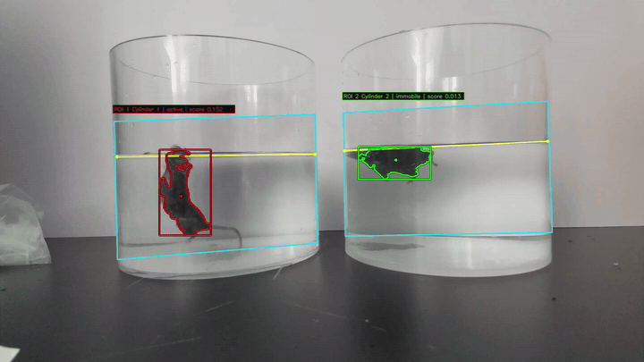
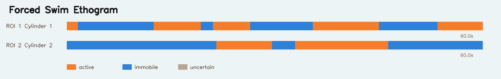

# MouseScope

<p align="center">
  
</p>

<p align="center">
  <strong>面向小鼠行为学视频分析的桌面软件平台</strong><br/>
  <strong>Desktop software platform for mouse behavioral video analysis.</strong>
</p>

<p align="center">
  支持悬尾实验 TST、强迫游泳 FST、水迷宫 MWM、旷场实验 OFT、新奇物体识别 NOR、高架十字迷宫 EPM、Y 迷宫与明暗箱<br/>
  Supports Tail Suspension Test, Forced Swim Test, Morris Water Maze, Open Field Test, Novel Object Recognition, Elevated Plus Maze, Y-Maze, and Light-Dark Box.
</p>

<p align="center">
  
  
  
  
  
</p>

<p align="center">
  
  <br/>
  <sub>MouseScope Desktop v3.5.0 首页 · Project Workspace and Quick Analysis entry points</sub>
</p>

## MouseScope 是什么 | Overview

MouseScope 是一套面向实验室日常工作的本地桌面平台，用于把小鼠行为学视频从项目组织、视频导入、分析范围配置、标定与 ROI 设置、参数预览、批量分析到结果复核串成一条统一流程，覆盖悬尾、强迫游泳、水迷宫、旷场、新奇物体识别、高架十字迷宫、Y 迷宫和明暗箱等常用实验，同时保留 `项目工作台 Project Workspace` 与 `快速分析 Quick Analysis` 两种入口。

MouseScope is a local desktop platform for practical lab workflows. It connects project organization, video import, analysis-range setup, calibration, ROI or maze setup, parameter preview, batch analysis, and result review in one interface. It covers common assays including TST, FST, Morris Water Maze, OFT, NOR, EPM, Y-Maze, and Light-Dark Box while the `Project Workspace` and `Quick Analysis` entry points remain available.

## 两种入口 | Two Entry Points

### 项目工作台 | Project Workspace

适合正式实验、长期课题和需要按动物/组别整理结果的场景。

Use this for formal studies, long-term projects, and workflows where results must be organized by animal and group.

- 项目列表与项目文件夹管理。
  Project list and local project-folder management.
- 组别管理和小鼠编号批量生成。
  Group management and bulk animal-code generation.
- 视频导入、视频元数据索引、实验类型绑定，以及逐视频起止时间、FPS 和画面方向配置。
  Video import, metadata indexing, experiment-type assignment, and per-video start/end time, FPS, and orientation setup.
- 同一实验类型的视频记录可批量进入配置与分析。
  Records of the same assay type can be configured and analyzed together.
- 项目运行记录会回写到项目结果页，并可直接打开结果目录。
  Project run records are written back to the project result page with direct folder access.

### 快速分析 | Quick Analysis

适合临时分析、试跑参数、单个视频或不需要项目归档的小批量任务。

Use this for temporary runs, parameter trials, single videos, or small batches that do not need project-level organization.

- 支持拖拽上传或填写本机视频/文件夹路径。
  Supports drag-and-drop upload or local file/folder paths.
- 统一使用分析配置页设置逐视频起止时间、FPS 和画面方向，再进入标定与 ROI/区域配置。
  Uses the shared analysis-configuration page for per-video time ranges, FPS, and orientation before calibration and ROI/zone setup.
- 支持多视频批量工作台，为每个视频独立保存配置。
  Supports batch workspace with per-video configuration.

## 全局设置 | Global Settings

- `图像样式 Image Style` 用于统一轨迹图、热力图、结果拼图和图例颜色，并提供按实验类型切换的真实渲染预览。
  `Image Style` controls track-map, heatmap, result-grid, and legend colors with real rendered previews for each assay.
- `实验默认配置 Experiment Defaults` 汇总各实验模块的可配置参数。保存后的默认值用于新建分析，具体视频和 ROI 中仍可继续覆盖。
  `Experiment Defaults` centralizes configurable assay parameters. Saved defaults apply to newly created analyses and can still be overridden for individual videos and ROIs.
- 全局默认值不会追溯修改已经保存或已经运行的任务。
  Global defaults do not retroactively alter saved or completed runs.

## 支持实验模块 | Supported Assays

| 实验模块 Assay | 典型用途 Typical Use | 核心设置 Core Setup | 主要指标 Main Metrics |
|---|---|---|---|
| `TST` 悬尾实验 / Tail Suspension Test | 不动与挣扎状态分析 / immobility and struggling analysis | 身长标定、ROI、时间窗 / body-length calibration, ROI, time windows | 不动时间、挣扎时间、不动比例、首次不动潜伏期 / immobility time, struggling time, immobility percent, latency |
| `FST` 强迫游泳 / Forced Swim Test | 漂浮不动与活动状态分析 / immobility and active-state analysis | 圆筒 ROI、直径线、检测遮掩框、时间窗 / cylinder ROI, diameter line, detection mask, time windows | 不动时间、不动比例、片段数、潜伏期、ethogram、活动曲线 / immobility time, percent, bouts, latency, ethogram, activity curve |
| `MWM` 水迷宫 / Morris Water Maze | 空间学习、目标象限和平台搜索 / spatial learning, target quadrant, and platform search | 泳池椭圆、平台椭圆、象限坐标轴、检测遮掩框 / pool ellipse, platform ellipse, quadrant axes, detection mask | 逃逸潜伏期、平台进入、目标象限时间、趋边、标准圆轨迹图/热图 / escape latency, platform entries, target-quadrant occupancy, thigmotaxis, standard circular maps |
| `OFT` 旷场实验 / Open Field Test | 自主活动与中心区偏好 / locomotion and center preference | 4 角场地、可选检测遮掩框、时间窗 / 4-corner arena, optional detection mask, time windows | 总路程、速度、中心区时间与比例、壁区时间与比例 / distance, speed, center metrics, wall metrics |
| `NOR` 新奇物体识别 / Novel Object Recognition | 新奇与熟悉物体探索差异 / novel vs familiar object exploration | 场地 4 角、2 个物体中心、第二灰度阈值、可选检测遮掩框 / arena corners, two objects, body/tail threshold, optional mask | 新奇探索时间、熟悉探索时间、辨别指数、偏好指数、头向质量字段 / exploration time, discrimination, preference, head-direction quality fields |
| `EPM` 高架十字迷宫 / Elevated Plus Maze | 开放臂与封闭臂探索 / open-arm vs closed-arm exploration | 中心区 + 2 开放臂 + 2 封闭臂手动画区 / center, two open arms, two closed arms | 开放臂时间、开放臂进入次数、开放臂进入占比、首次进入开放臂潜伏期 / open-arm time, open entries, open-entry ratio, first open-entry latency |
| `Y-Maze` Y 迷宫 / Y-Maze | 入臂序列与自发交替 / arm sequence and spontaneous alternation | 三角形中心区 + 3 条臂手动画区 / triangular center and three arms | 各臂停留、总入臂数、交替次数、交替率 / arm occupancy, total entries, alternation count, alternation rate |
| `LDB` 明暗箱 / Light-Dark Box | 避亮与探索冲突 / light avoidance and exploration conflict | 暗箱可见：明室 + 暗室 + 可选门区；暗箱不可见：明室 + 可选门区 / visible dark: light + dark + optional doorway; invisible dark: light + optional doorway | 明室/暗室时间、进入次数、转换次数、首次入明室潜伏期；暗箱可见时另有轨迹/热图/QC / zone time, entries, transitions, first-light latency; trackmaps/heatmaps/QC when visible |

## 工作流 | Workflow

### 项目模式 | Project Mode

1. 创建项目并进入项目首页。
   Create a project and open the project page.
2. 添加组别，批量生成或录入小鼠编号。
   Add groups and create or enter animal codes.
3. 导入视频，并为每个视频选择实验类型。
   Import videos and assign an experiment type to each video.
4. 在分析配置页为每个视频确认起止时间、FPS 和画面方向。
   Confirm each video's start/end time, FPS, and orientation on the analysis-configuration page.
5. 进入标定与 ROI/arena/cylinder/maze unit 配置，并选择对应项目小鼠。
   Bind each ROI, arena, cylinder, or maze unit to a project animal.
6. 完成参数预览、启动分析，并在项目结果页查看运行记录。
   Tune parameters, start analysis, and review runs from the project result page.

### 快速分析模式 | Quick Analysis Mode

1. 选择实验模块并上传一个或多个视频。
   Choose an assay and upload one or more videos.
2. 在分析配置页为每个视频确认起止时间、FPS 和画面方向。
   Confirm per-video start/end time, FPS, and orientation on the analysis-configuration page.
3. 根据实验类型完成标定、ROI、迷宫区域、目标物、检测遮掩框和关键参数设置，并用预览检查检测质量。
   Configure calibration, ROIs, maze zones, objects, detection masks, and key parameters, then check preview quality.
4. 多视频时进入批量工作台，逐个确认配置完整性。
   For multi-video sessions, use the batch workspace to confirm each video's setup.
5. 启动分析，并在任务中心或监控页查看进度与结果。
   Start analysis and review progress or results in Monitor and Task Center.

## 结果输出 | Outputs

MouseScope 输出的不只是原始表格，也包括便于复核和汇报的材料。

MouseScope exports not only raw tables, but also review-friendly materials.

- 逐帧日志和 summary CSV。
  Framewise logs and summary CSV files.
- TXT 报告，包含中英双语指标标签。
  TXT reports with bilingual metric labels.
- 标注结果视频，优先使用 FFmpeg H.264 编码，无法使用时回退到 OpenCV writer。
  Annotated videos, preferably encoded with FFmpeg H.264 and falling back to OpenCV writer when needed.
- TST/FST ethogram 与活动曲线。
  TST/FST ethograms and activity curves.
- MWM/OFT/NOR/EPM/Y-Maze 轨迹图、热图或区域统计图；LDB 仅在暗箱可见模式下导出轨迹图/热图。
  Trackmaps, heatmaps, or zone summaries for MWM, OFT, NOR, EPM, and Y-Maze; LDB exports trackmaps/heatmaps only when the dark chamber is visible.
- 项目分析结果会进入项目目录下的 `results/`，便于按课题归档。
  Project runs are saved under the project's `results/` directory for study-level organization.
- 每次分析使用独立结果目录并保存运行快照；任务中心可在原视频未变化时按原配置重新运行，并比较科研 CSV/TSV/TXT 结果的一致性。
  Each analysis uses an isolated result directory and stores a run snapshot. Task Center can replay the saved configuration when source videos are unchanged and compare scientific CSV/TSV/TXT outputs for consistency.

## 结果示例 | Featured Results

### TST 悬尾实验 | Tail Suspension Test

<p align="center">
  
  <br/>
  <sub>TST 标注结果视频 · TST annotated result video</sub>
</p>

<table>
  <tr>
    <td align="center">
      
      <br/>
      <sub>软件评分与人工评分相关性 · Software vs manual correlation</sub>
    </td>
    <td align="center">
      
      <br/>
      <sub>逐时程对照示例 · Ethogram-style comparison</sub>
    </td>
  </tr>
</table>

### FST 强迫游泳 | Forced Swim Test

<p align="center">
  
  <br/>
  <sub>FST 标注结果视频 · FST annotated result video</sub>
</p>

<p align="center">
  
  <br/>
  <sub>FST 状态时序图 · FST ethogram</sub>
</p>

### OFT 旷场实验 | Open Field Test

<p align="center">
  
  <br/>
  <sub>OFT 分析演示 · OFT analysis demo</sub>
</p>

<table>
  <tr>
    <td align="center">
      
      <br/>
      <sub>旷场热图 · Open-field heatmaps</sub>
    </td>
    <td align="center">
      
      <br/>
      <sub>旷场轨迹图 · Open-field trackmaps</sub>
    </td>
  </tr>
</table>

### NOR 新奇物体识别 | Novel Object Recognition

<p align="center">
  
  <br/>
  <sub>NOR 预览与头向调参 · NOR preview and head-direction tuning</sub>
</p>

<table>
  <tr>
    <td align="center">
      
      <br/>
      <sub>NOR 热图 · NOR heatmaps</sub>
    </td>
    <td align="center">
      
      <br/>
      <sub>NOR 轨迹图 · NOR trackmaps</sub>
    </td>
  </tr>
</table>

### EPM 与 Y-Maze

<table>
  <tr>
    <td align="center">
      
      <br/>
      <sub>高架十字迷宫轨迹图 · EPM trackmap</sub>
    </td>
    <td align="center">
      
      <br/>
      <sub>Y 迷宫轨迹图 · Y-Maze trackmap</sub>
    </td>
  </tr>
</table>

## 快速开始 | Quick Start

### 方式一：下载打包版本 | Option 1: Download the Packaged Build

1. 打开 [Releases](https://github.com/fujiacheng3/MouseScope/releases)。
   Open the [Releases](https://github.com/fujiacheng3/MouseScope/releases) page.
2. 下载最新压缩包并解压。
   Download and extract the latest archive.
3. 运行 `MouseScope.exe`。
   Run `MouseScope.exe`.
4. 软件会在本机浏览器中打开本地界面。
   The local interface will open in your browser.

大多数实验室用户建议使用打包版本。

For most lab users, the packaged build is recommended.

### 方式二：从源码运行 | Option 2: Run from Source

```bash
git clone https://github.com/fujiacheng3/MouseScope.git
cd MouseScope
pip install -r requirements.txt
python app.py
```

默认运行后访问本机 Web 界面。不同版本或打包环境中端口可能以实际启动提示为准。

After startup, open the local web interface. The exact port may follow the startup message in your environment.

## 依赖 | Dependencies

核心依赖记录在 `requirements.txt` 中：

Core dependencies are listed in `requirements.txt`:

- `flask`
- `opencv-python`
- `numpy`
- `pandas`
- `imageio-ffmpeg`

`imageio-ffmpeg` 用于在打包版或无系统 FFmpeg 的环境中提供更稳定的标注视频编码能力。

`imageio-ffmpeg` helps provide more stable annotated-video encoding in packaged builds or environments without a system FFmpeg.

## 本地数据与隐私 | Local Data and Privacy

MouseScope Desktop 默认在本机保存运行数据，不引入账号、云同步或服务器端协作。

MouseScope Desktop stores runtime data locally by default. It does not introduce accounts, cloud sync, or server-side collaboration.

- 在程序目录可写时，快速分析与项目数据保存在 EXE 同级 `data/` 下；程序目录不可写时自动使用 `%LOCALAPPDATA%\MouseScope\data`。
  When the application directory is writable, quick-analysis and project data are stored under `data/` beside the EXE; otherwise MouseScope automatically uses `%LOCALAPPDATA%\MouseScope\data`.
- `data/uploads/`、`data/results/` 和 `data/history/` 保存快速分析数据；`data/projects/` 保存项目数据库、视频索引和项目结果目录。
  `data/uploads/`, `data/results/`, and `data/history/` hold quick-analysis data; `data/projects/` holds project databases, video indexes, and project result folders.
- 不建议把 `data/` 下的实验数据、数据库、密钥或视频文件提交到 Git。
  Do not commit experimental data, local databases, secrets, or videos under `data/`.

## 仓库结构 | Repository Structure

```text
MouseScope/
|- app.py
|- routes/
|  |- pages.py
|  |- api.py
|  |- projects.py
|  \- project_api.py
|- core/
|  |- vision_tracker.py
|  |- forced_swim.py
|  |- open_field.py
|  |- novel_object.py
|  |- elevated_plus.py
|  |- y_maze.py
|  |- light_dark_box.py
|  |- maze_zone_utils.py
|  |- water_maze.py
|  \- spatial_render.py
|- services/
|  |- analysis_builders.py
|  |- analysis_history.py
|  |- analysis_runtime.py
|  |- analysis_sessions.py
|  |- analysis_windows.py
|  |- experiment_defaults.py
|  |- debug_preview.py
|  |- experiment_registry.py
|  |- light_dark_session.py
|  |- payload_geometry.py
|  |- project_store.py
|  |- session_store.py
|  |- reproducibility.py
|  |- water_maze_session.py
|  |- video_export.py
|  |- video_frame_reader.py
|  |- video_metadata.py
|  |- video_orientation.py
|  \- video_timebase.py
|- templates/
|  |- projects.html
|  |- project_home.html
|  |- upload.html
|  |- tasks.html
|  |- calibrate*.html
|  |- monitor*.html
|  \- manual_*_content.html
|- static/
|  |- css/
|  |- js/
|  \- img/
|- docs/
|  \- assets/
|- tests/
|- MouseScope.spec
\- requirements.txt
```

## 适用场景 | Typical Use Cases

- 正式实验项目中按组别、小鼠、实验类型和视频整理数据。
  Organizing formal studies by group, animal, assay type, and video.
- 多视频、多 arena、多 ROI 或多迷宫单元的批量分析。
  Batch analysis across multiple videos, arenas, ROIs, or maze units.
- 需要统一配置、减少手工整理错误的实验室工作流。
  Lab workflows that need standardized setup and fewer manual file-handling errors.
- 需要快速导出标注视频、CSV、TXT 报告、轨迹图和热图用于复核或组会汇报。
  Quickly exporting annotated videos, CSV files, TXT reports, trackmaps, and heatmaps for review or lab meetings.
- 希望把分析流程交接给非程序背景同学使用。
  Handing the workflow over to lab members without programming backgrounds.

## 局限与说明 | Limitations and Notes

- MouseScope 是研究辅助工具，正式统计分析前仍建议抽查原始视频与标注结果视频。
  MouseScope is a research-assistance tool. Raw videos and annotated outputs should still be checked before formal interpretation.
- 跟踪效果会受到光照、背景、阴影、反光、视角稳定性和视频质量影响。
  Tracking quality depends on lighting, background, shadows, glare, camera stability, and video quality.
- MouseScope 主要基于经典计算机视觉方法，不等同于完整姿态估计。
  MouseScope mainly uses classical computer vision and is not equivalent to full pose estimation.
- NOR 探索判定包含头向和尾部证据的启发式逻辑，不能完全替代人工专业判断。
  NOR exploration scoring uses heuristic head-direction and tail-evidence logic and should not fully replace expert review.

## 引用 | Citation

如果 MouseScope 对你的工作有帮助，欢迎按平台版本引用。

If MouseScope helps your work, please cite the platform version below.

```bibtex
@software{fu2026mousescope,
  author  = {Fu, Jiacheng},
  title   = {MouseScope: Mouse Behavioral Video Analysis Platform},
  year    = {2026},
  url     = {https://github.com/fujiacheng3/MouseScope},
  version = {3.5.0}
}
```

Plain text:

> Fu, J. (2026). *MouseScope: Mouse behavioral video analysis platform* (Version 3.5.0) [Software]. GitHub. https://github.com/fujiacheng3/MouseScope

## 许可与联系 | License & Contact

- License: `GPL-3.0-or-later`
- Author: Jiacheng Fu
- Email: 2583348593@qq.com
- GitHub: https://github.com/fujiacheng3/MouseScope

<p align="center">
  为真实实验流程而设计，从临时分析走向项目化数据整理。<br/>
  Built for real lab workflows, from quick analysis to project-level organization.
</p>
