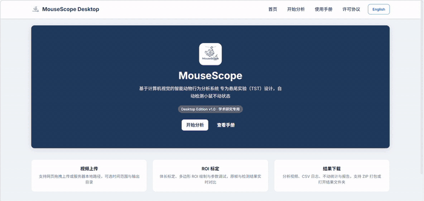

# MouseScope

<p align="center">
  
</p>

<p align="center">
  
</p>

<p align="center">
  <strong>面向小鼠行为学视频分析的桌面软件</strong><br/>
  支持 <strong>悬尾实验（Tail Suspension Test, TST）</strong> 与 <strong>旷场实验（Open Field Test, OFT）</strong>
</p>

<p align="center">
  A Windows-first desktop app for automated mouse behavior analysis.
</p>

<p align="center">
  
  
  
  
  
</p>

> 鼠行为视频分析不应该被繁琐的脚本和手工统计拖慢。MouseScope 希望把常用实验做成真正能落地的桌面工具。

---

## 项目简介 | Overview

**MouseScope** 是一个面向实验室日常使用场景的 Windows 桌面软件。  
它采用本地浏览器界面（local web UI）+ Python / OpenCV 分析后端的方式，帮助用户完成从视频导入、参数标定、批量分析到结果导出的完整流程。

当前版本已经支持两类实验：

| 实验模块 Module | 主要用途 | 典型输出 |
|---|---|---|
| **悬尾实验 TST** | 多 ROI 小鼠不动 / 挣扎自动分析 | 标注视频、逐帧日志 CSV、不动性汇总 CSV、TXT 报告 |
| **旷场实验 OFT** | 多 arena 轨迹追踪、中心区 / 墙区统计、轨迹图与热图输出 | 标注视频、轨迹 CSV、summary CSV、bins CSV、热图、轨迹图、TXT 报告 |

---

## 核心亮点 | Highlights

- **一个软件支持多实验**：同一套桌面工作流下完成 TST 与 OFT 分析。
- **适合拼接视频 / 多笼位视频**：支持多 ROI / 多 arena。
- **每个 ROI 可单独命名**：更适合真实实验中的多组、多笼位批处理。
- **每个 ROI 可设精确统计时间**：便于跳过预处理阶段或只统计指定时间窗。
- **OFT 支持透视校正**：四角标定后统一映射到标准方形坐标，轨迹图更规整。
- **支持手动输入本地路径**：可直接粘贴 Windows 路径，无需一定通过文件选择器。
- **中英界面切换**：软件前端支持 Chinese / English。
- **可打包为 EXE**：适合直接分发给实验室成员使用。

---

## 展示与效果 | Demo

### 悬尾实验（TST）演示

<table>
  <tr>
    <td align="center">
      
      <br/>
      <sub>上传、标定、绘制 ROI、分析与导出结果</sub>
    </td>
    <td align="center">
      
      <br/>
      <sub>自动识别不动状态并输出可视化结果</sub>
    </td>
  </tr>
</table>

### 旷场实验（OFT）演示

<p align="center">
  
  <br/>
  <sub>多 arena 旷场视频分析示例</sub>
</p>

<table>
  <tr>
    <td align="center">
      
      <br/>
      <sub>旷场热图（heatmaps）</sub>
    </td>
    <td align="center">
      
      <br/>
      <sub>透视校正后的轨迹图（track maps）</sub>
    </td>
  </tr>
</table>

### 软件主界面

<p align="center">
  
</p>

### TST 验证示意

<table>
  <tr>
    <td align="center">
      
      <br/>
      <sub>软件分析与人工评分的一致性</sub>
    </td>
    <td align="center">
      
      <br/>
      <sub>33 只小鼠逐段行为对照示意</sub>
    </td>
  </tr>
</table>

---

## 快速开始 | Quick Start

### 方式一：直接运行打包版 EXE

1. 前往 [Releases](https://github.com/fujiacheng3/MouseScope/releases) 下载最新版本。
2. 解压压缩包。
3. 运行 `MouseScope.exe`。
4. 软件会自动在浏览器中打开 `http://localhost:8080`。

### 方式二：从源码运行

```bash
git clone https://github.com/fujiacheng3/MouseScope.git
cd MouseScope
pip install -r requirements.txt
python app.py
```

随后在浏览器中打开 `http://localhost:8080`。

---

## 典型工作流 | Workflow

### TST 工作流

1. 上传一个或多个悬尾实验视频。
2. 如有需要，先做体长标定。
3. 绘制一个或多个 ROI。
4. 为每个 ROI 命名，并设置统计时间窗。
5. 调整检测参数并开始分析。
6. 导出标注视频、逐帧日志、不动性统计表和 TXT 报告。

### OFT 工作流

1. 上传一个或多个旷场实验视频。
2. 选择实验类型为 `Open Field Test`。
3. 为每个 arena 点击四个角点，并输入场地边长。
4. 为每个 ROI / arena 命名，并按需设置精确统计时间。
5. 调整阈值、形态学参数、中心区比例、墙区边界、分箱时长等参数。
6. 导出轨迹 CSV、summary CSV、分箱统计、热图、轨迹图和 TXT 报告。

---

## 输出文件 | Output Files

### TST 输出

| 文件名模式 | 含义 |
|---|---|
| `*_analyzed.mp4` | 标注后的视频结果 |
| `*_logs.csv` | 逐帧日志 |
| `*_immobility.csv` | 各 ROI 不动性统计汇总 |
| `*_report.txt` | 文本报告 |

### OFT 输出

| 文件名模式 | 含义 |
|---|---|
| `*_oft_analyzed.mp4` | 旷场标注视频 |
| `*_oft_tracks.csv` | 逐帧轨迹数据 |
| `*_oft_summary.csv` | 各 ROI 汇总指标 |
| `*_oft_bins.csv` | 按时间分箱的统计结果 |
| `*_oft_report.txt` | 文本报告 |
| `*_oft_heatmaps.png` | 热图结果 |
| `*_oft_trackmaps.png` | 轨迹图结果 |

---

## 适用场景 | Suitable Use Cases

- 实验室内部日常视频分析
- 多笼位 / 多 arena 拼接视频处理
- TST 不动性自动统计
- OFT 路程、速度、中心区时间、墙区时间等指标统计
- 需要给同事直接发 EXE 使用的 Windows 环境

---

## 技术栈 | Tech Stack

| 层级 | 技术 |
|---|---|
| 后端 Backend | Python, Flask |
| 视觉分析 CV Pipeline | OpenCV、背景分离、轮廓检测、传统运动分析 |
| 数据处理 Data | NumPy, Pandas |
| 前端 Frontend | HTML, CSS, Vanilla JavaScript |
| 打包 Packaging | PyInstaller |

---

## 项目结构 | Repository Structure

```text
MouseScope/
|- app.py                      # Flask app and workflow orchestration
|- core/
|  |- vision_tracker.py        # TST 分析主流程
|  |- open_field.py            # OFT 轨迹分析、统计与绘图
|  \- performance_utils.py
|- templates/                  # 页面模板
|- static/                     # 静态资源
|- docs/assets/                # README 展示素材
|- data/results/               # 本地分析输出示例
\- MouseScope.spec             # PyInstaller 打包配置
```

---

## 运行环境 | Requirements

- Windows 10 / 11 x64
- Python 3.9 至 3.11（源码运行时）
- 建议 8 GB 及以上内存
- 建议使用多核 CPU 以提高批处理速度

---

## 使用说明与注意事项 | Notes

- 本软件主要作为 **科研辅助工具（research tool）** 使用。
- 分析质量会受到视频清晰度、光照、背景均匀性、相机角度和实验布置影响。
- 对于正式实验数据，建议在发表或关键结论使用前进行人工复核。
- OFT 当前为经典视觉轨迹方案，不包含姿态估计级别的复杂细行为识别。

---

## 引用 | Citation

如果 MouseScope 对你的研究有帮助，欢迎按以下格式引用：

```bibtex
@software{fu2026mousescope,
  author  = {Fu, Jiacheng},
  title   = {MouseScope: Automated Mouse Behavior Analysis Software for Tail Suspension Test and Open Field Test},
  year    = {2026},
  url     = {https://github.com/fujiacheng3/MouseScope},
  version = {1.0}
}
```

Plain text:

> Fu, J. (2026). *MouseScope: Automated mouse behavior analysis software for tail suspension test and open field test* (Version 1.0) [Software]. GitHub. https://github.com/fujiacheng3/MouseScope

---

## 许可证 | License

仅限学术与非商业用途。  
详见 [LICENSE](LICENSE)。

---

## 联系方式 | Contact

- 作者 Author: Jiacheng Fu
- 邮箱 Email: 2583348593@qq.com
- GitHub: https://github.com/fujiacheng3/MouseScope

---

<p align="center">
  Built for practical behavioral video analysis in real lab workflows.
</p>
