# MouseScope

<p align="center">
  
</p>

<p align="center">
  <strong>面向真实实验流程的小鼠行为学视频分析桌面平台</strong><br/>
  <span>Desktop platform for practical mouse behavioral video analysis in real lab workflows.</span>
</p>

<p align="center">
  支持 <strong>悬尾实验 TST</strong>、<strong>旷场实验 OFT</strong>、<strong>新奇物体识别 NOR</strong>、<strong>高架十字迷宫 EPM</strong> 与 <strong>Y 迷宫 Y-Maze</strong>
</p>

<p align="center">
  
  
  
  
  
</p>

<p align="center">
  <a href="https://github.com/fujiacheng3/MouseScope/releases">下载 Windows 版</a>
  ·
  <a href="#workflow-demo">查看演示</a>
  ·
  <a href="docs/releases/v2.0.0.md">v2.0.0 Release Notes</a>
  ·
  <a href="docs/system_design.md">系统设计文档</a>
</p>

<p align="center">
  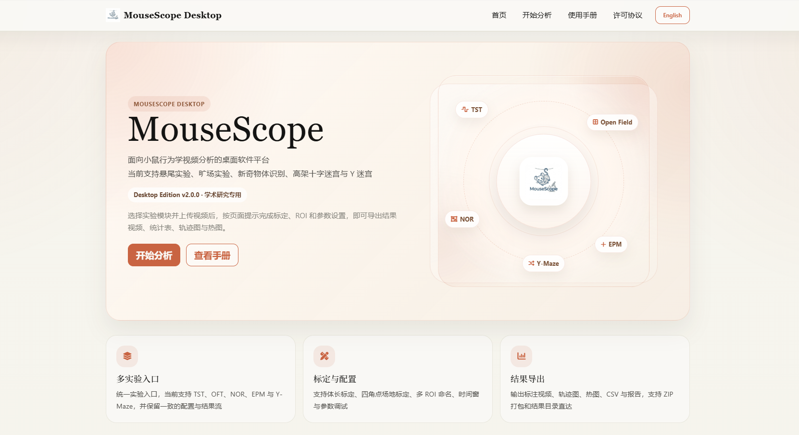
  <br/>
  <sub>MouseScope v2.0.0 当前首页界面</sub>
</p>

## MouseScope 是什么 | Overview

MouseScope 是一套面向实验室日常工作的桌面分析平台，用来把小鼠行为学视频从“上传、标定、ROI 或迷宫区域设置、参数调整、批量检查、正式分析、结果复核”串成一条统一流程。  
它不是只服务单一实验的脚本集合，而是尽量让不同实验模块共用一致的操作逻辑，方便直接交给实验人员使用。

MouseScope is designed as a practical desktop workbench rather than a collection of one-off scripts.

## v2.0.0 核心升级 | Major Update

- 新增 **高架十字迷宫 EPM** 与 **Y 迷宫 Y-Maze** 两个实验模块。
- 批量模式重构为 **上传 -> 批量工作台 -> 单视频独立配置 -> 统一启动分析**。
- 统一了多模块的 **ROI / 时间窗 / 检测遮掩框 / 参数预览** 逻辑。
- EPM 改为 **5 区全手动画区**，Y 迷宫改为 **三角形中心区 + 三条臂** 的真实实验几何。
- 迷宫模块的热图和轨迹图改为 **标准模板坐标系** 输出，不再跟随手画区域外形变形。
- 使用手册、TXT 报告字段和界面文案进一步补齐为 **中英双语**。
- 补充了 **系统设计文档** 与基础 smoke tests，方便后续继续维护与扩展。

## 为什么用 MouseScope | Why MouseScope

- 一个入口覆盖多种常见小鼠行为学实验，不需要在不同脚本和表格之间来回切换。
- 支持单视频与多视频工作流，适合真实实验室里常见的批量处理场景。
- 重要配置都可视化，包括 ROI、迷宫分区、目标物、时间窗、检测遮掩框与参数预览。
- 结果不仅便于导出，也便于复核，适合做日常分析、组会汇报和论文前检查。
- 保留桌面软件体验，尽量降低对编程环境的依赖，方便非程序背景同学直接上手。

<a id="workflow-demo"></a>

## 统一工作流演示 | Workflow Demo

<p align="center">
  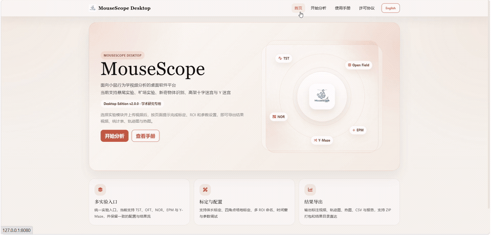
  <br/>
  <sub>统一流程：选择实验 -> 上传视频 -> 配置 ROI / 迷宫 -> 预览与调参 -> 分析与导出</sub>
</p>

## 支持实验模块 | Supported Assays

| 实验模块 | 典型用途 | 核心设置 | 主要指标 |
|---|---|---|---|
| `TST` 悬尾实验 | 不动/挣扎状态分析 | 身长标定、ROI、统计时间窗 | 总时长、不动时长、不动比例、挣扎时长、挣扎比例、首次不动潜伏期 |
| `OFT` 旷场实验 | 自主活动与中心区/边缘区偏好分析 | 4 角场地、可选遮掩框、时间窗 | 总路程、平均速度、最大速度、中心区时间/比例/进入次数/潜伏期、壁区时间/比例、运动/静止时间 |
| `NOR` 新奇物体识别 | 目标物探索与偏好分析 | 场地 4 角、2 个物体中心、可选遮掩框、时间窗 | 新奇物体探索时间、熟悉物体探索时间、总探索时间、辨别指数、偏好指数、头部支持探索时间 |
| `EPM` 高架十字迷宫 | 开放臂/封闭臂探索与焦虑样行为分析 | 中心区 + 2 开放臂 + 2 封闭臂手动画区、可选遮掩框、时间窗 | 开放臂/封闭臂/中心区时间、开放臂时间占比、开放臂进入次数、封闭臂进入次数、开放臂进入占比、首次进入开放臂潜伏期 |
| `Y-Maze` Y 迷宫 | 入臂序列与自发交替分析 | 三角形中心区 + 3 条臂手动画区、可选遮掩框、时间窗 | A/B/C 臂停留时间、各臂入臂次数、总入臂数、交替次数、交替机会数、交替率 |

## 结果示例 | Featured Results

### 1. 悬尾实验 TST

MouseScope 会记录每个 ROI 的不动与挣扎状态，并输出便于回看的视频叠加结果与统计结果。

<p align="center">
  
  <br/>
  <sub>TST 结果演示：状态叠加、时间窗统计与结果复核</sub>
</p>

<table>
  <tr>
    <td align="center">
      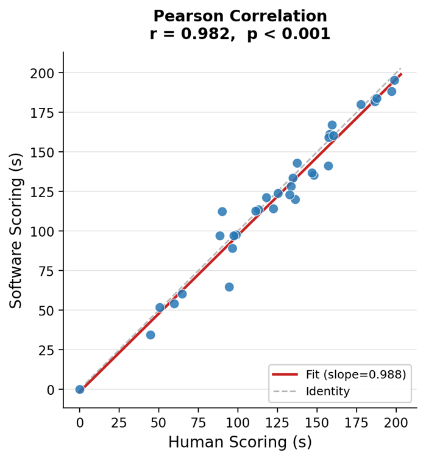
      <br/>
      <sub>软件评分与人工评分相关性</sub>
    </td>
    <td align="center">
      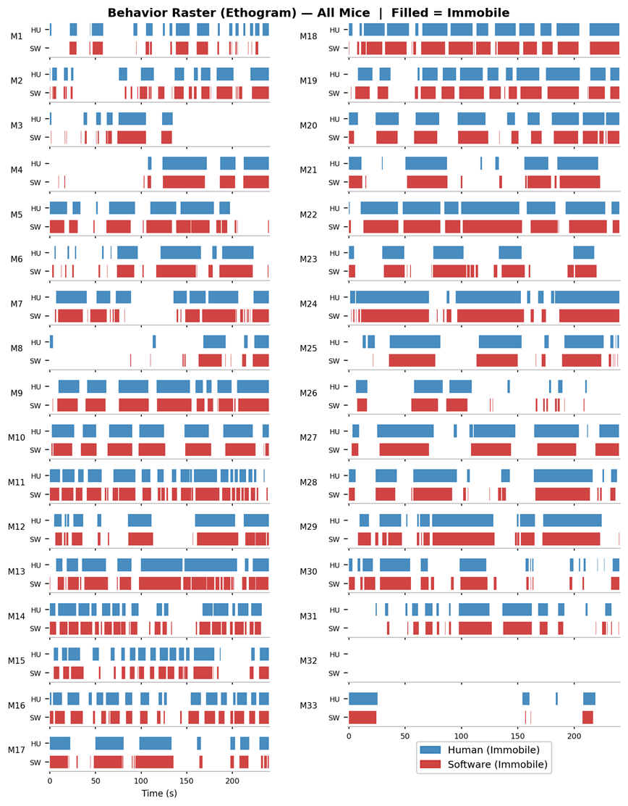
      <br/>
      <sub>33 只小鼠的逐时程对照示例</sub>
    </td>
  </tr>
</table>

### 2. 旷场实验 OFT

OFT 模块关注自主活动、中心区偏好与空间占据情况，适合快速获得常用的运动学和空间统计指标。

<p align="center">
  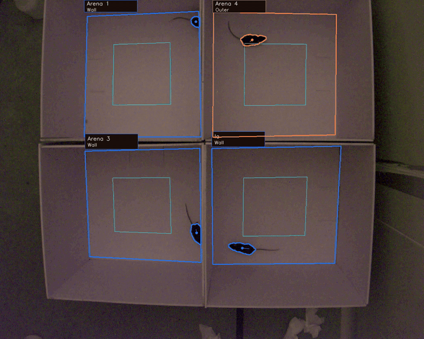
  <br/>
  <sub>OFT 演示：场地配置、追踪与结果可视化</sub>
</p>

<table>
  <tr>
    <td align="center">
      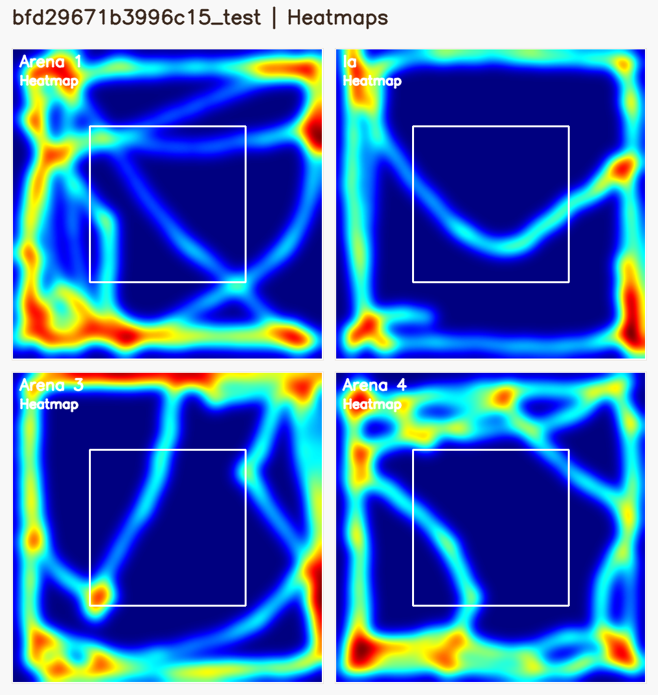
      <br/>
      <sub>旷场热图（Heatmaps）</sub>
    </td>
    <td align="center">
      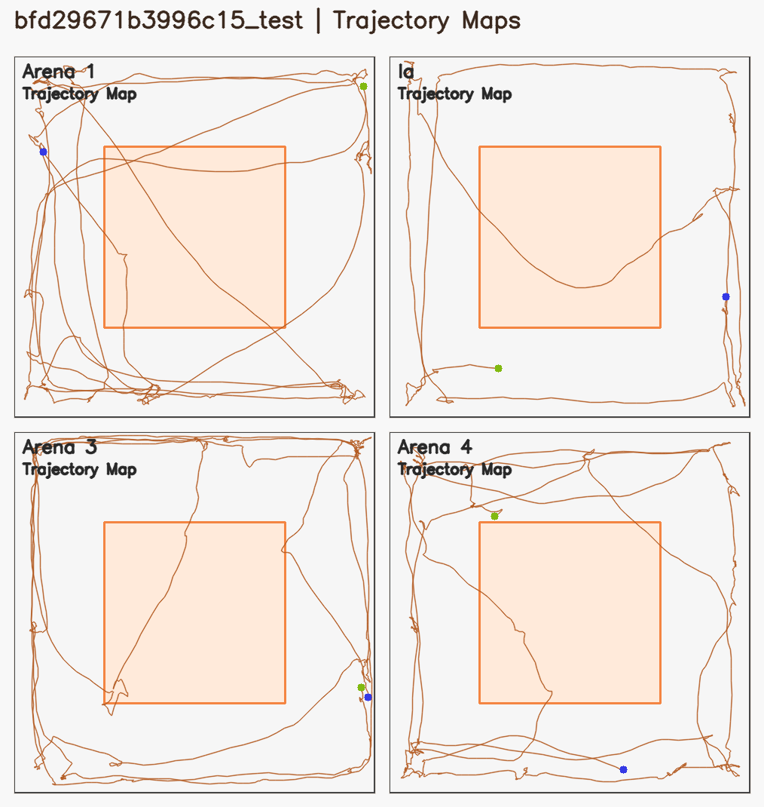
      <br/>
      <sub>旷场轨迹图（Trackmaps）</sub>
    </td>
  </tr>
</table>

### 3. 新奇物体识别 NOR

NOR 模块用于量化小鼠对熟悉物体和新奇物体的探索差异，支持探索时间、偏好与辨别指标输出。

<table>
  <tr>
    <td align="center">
      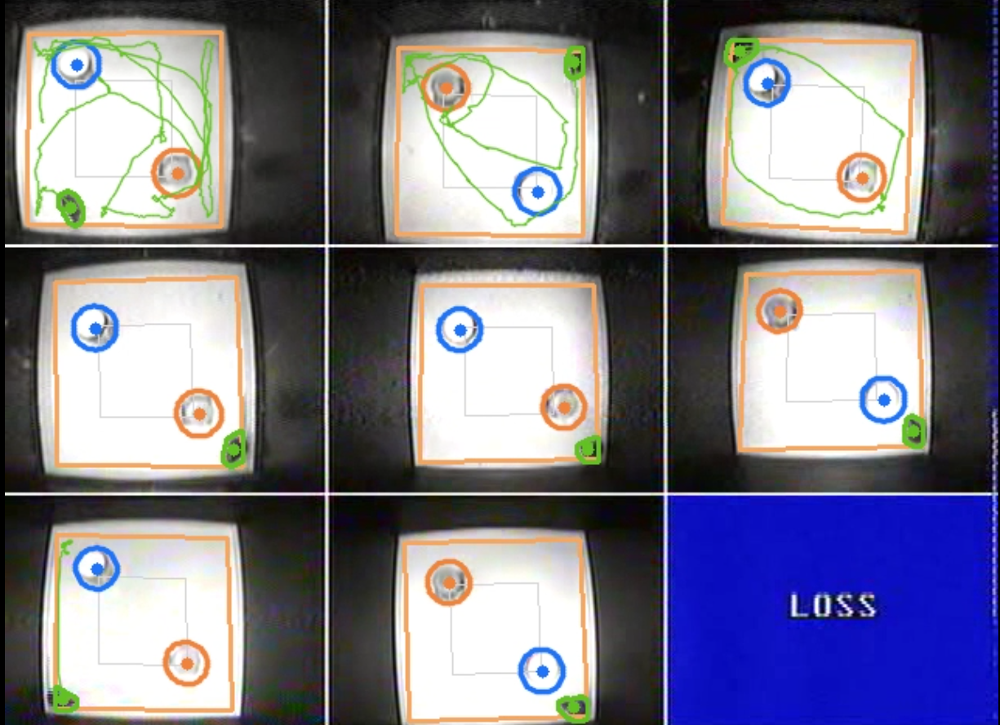
      <br/>
      <sub>场地与物体配置预览</sub>
    </td>
    <td align="center">
      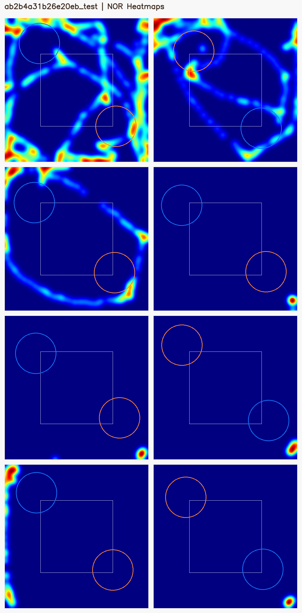
      <br/>
      <sub>NOR 热图（Heatmaps）</sub>
    </td>
    <td align="center">
      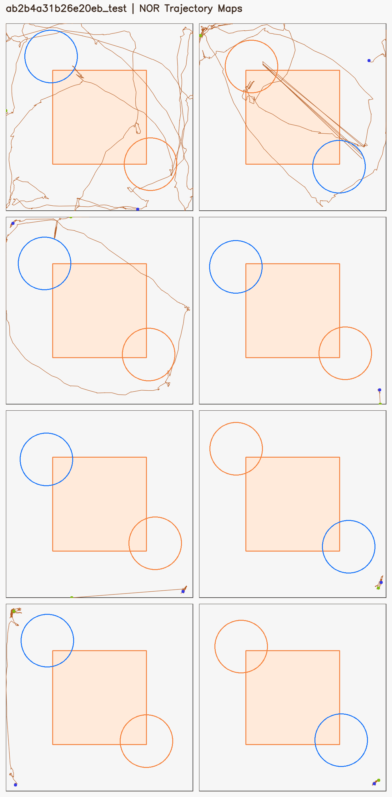
      <br/>
      <sub>NOR 轨迹图（Trackmaps）</sub>
    </td>
  </tr>
</table>

### 4. 新增迷宫模块：EPM 与 Y-Maze

v2.0.0 新增了两类迷宫实验模块，并把轨迹图与热图统一到标准迷宫模板坐标系，便于不同视频之间直观比较。

<table>
  <tr>
    <td align="center">
      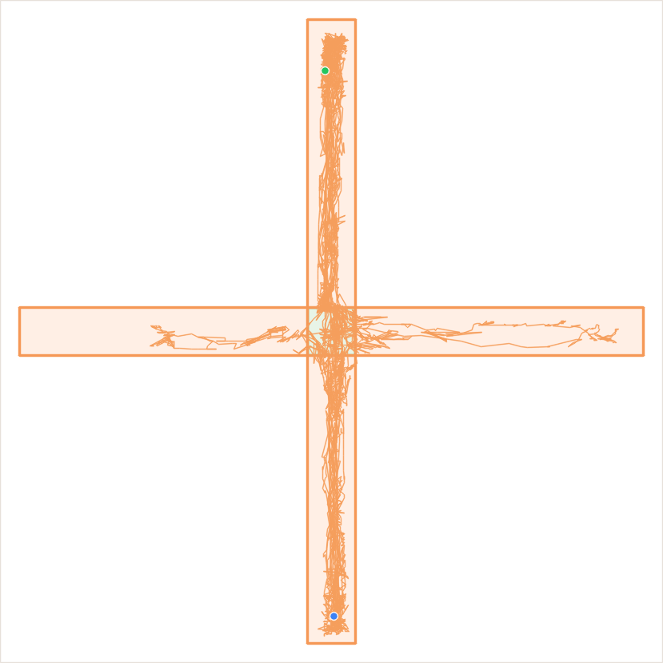
      <br/>
      <sub>高架十字迷宫 EPM 轨迹图</sub>
    </td>
    <td align="center">
      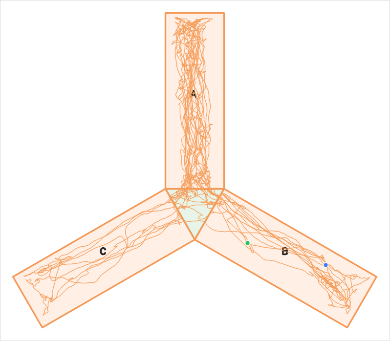
      <br/>
      <sub>Y 迷宫 Y-Maze 轨迹图</sub>
    </td>
  </tr>
</table>

## 可以得到什么结果 | What You Get

### 行为学核心指标

- `TST`：不动时间、挣扎时间、不动比例、挣扎比例、首次不动潜伏期
- `OFT`：总路程、速度、中心区/壁区时间与比例、中心区进入次数、中心区潜伏期
- `NOR`：新奇/熟悉物体探索时间、总探索时间、辨别指数、偏好指数
- `EPM`：开放臂/封闭臂/中心区时间、开放臂进入比例、首次进入开放臂潜伏期
- `Y-Maze`：各臂停留时间、总入臂数、交替次数、交替率

### 时序与分箱统计

- 支持逐帧轨迹与状态记录
- 支持固定时间分箱统计，便于观察实验过程中的变化趋势
- 支持按 ROI、按视频分别整理结果，适合多视频批量分析

### 复核可视化

- 标注结果视频（annotated video）
- 热图（heatmap）
- 轨迹图（trackmap）
- 批量结果目录，方便实验记录、复核与分享

## 统一使用路径 | Unified Workflow

1. 选择实验模块并上传一个或多个视频。
2. 根据实验类型完成场地、ROI、迷宫分区或目标物设置。
3. 设置时间窗、检测遮掩框与关键参数，并用预览检查是否稳定。
4. 多视频时先进入批量工作台，为每个视频单独保存配置。
5. 统一启动分析。
6. 查看结果视频、统计指标和空间可视化结果。

## 快速开始 | Quick Start

### 方式一：直接下载 Windows 版本

1. 打开 [Releases](https://github.com/fujiacheng3/MouseScope/releases)。
2. 下载最新的 Windows x64 压缩包。
3. 解压后运行 `MouseScope.exe`。
4. 软件会在本机浏览器中打开 `http://localhost:8080`。

大多数实验室用户建议直接使用 Windows 打包版本。  
For most lab users, the prebuilt Windows package is the recommended option.

### 方式二：从源码运行

```bash
git clone https://github.com/fujiacheng3/MouseScope.git
cd MouseScope
pip install -r requirements.txt
python app.py
```

## 适用场景 | Typical Use Cases

- 日常神经科学与行为学实验视频后处理
- 同批次多视频、多 arena 或多 ROI 分析
- 需要统一配置、减少人工整理错误的实验室工作流
- 需要快速生成组会汇报或论文前检查用的行为学结果图
- 希望把分析流程交接给非程序背景同学的场景

## 局限与说明 | Limitations and Notes

- MouseScope 是研究辅助工具，正式统计分析前仍建议抽查原始视频与结果视频。
- 跟踪效果会受到光照、背景、阴影、反光、视角稳定性和视频质量影响。
- 当前 OFT / NOR 仍以经典计算机视觉方法为主，并非完整的姿态估计级别行为解析。
- NOR 的探索判定包含头部方向启发式逻辑，不能完全替代人工专业判断。

## 仓库结构 | Repository Structure

```text
MouseScope/
|- app.py
|- core/
|  |- vision_tracker.py
|  |- open_field.py
|  |- novel_object.py
|  |- elevated_plus.py
|  |- y_maze.py
|  |- maze_zone_utils.py
|  \- spatial_render.py
|- services/
|  |- experiment_registry.py
|  |- analysis_builders.py
|  \- session_store.py
|- templates/
|- static/
|- tools/
|  |- smoke_routes_v2.py
|  \- smoke_short_analyses_v2.py
|- docs/
|  |- releases/
|  \- system_design.md
\- MouseScope.spec
```

## 引用 | Citation

如果 MouseScope 对你的工作有帮助，欢迎按平台版本引用：

```bibtex
@software{fu2026mousescope,
  author  = {Fu, Jiacheng},
  title   = {MouseScope: Mouse Behavioral Video Analysis Platform},
  year    = {2026},
  url     = {https://github.com/fujiacheng3/MouseScope},
  version = {2.0.0}
}
```

Plain text:

> Fu, J. (2026). *MouseScope: Mouse behavioral video analysis platform* (Version 2.0.0) [Software]. GitHub. https://github.com/fujiacheng3/MouseScope

## 许可与联系 | License & Contact

- License: `GPL-3.0-or-later`
- Author: Jiacheng Fu
- Email: 2583348593@qq.com
- GitHub: https://github.com/fujiacheng3/MouseScope

<p align="center">
  为真实实验流程而设计，而不是为了展示脚本本身。
</p>
