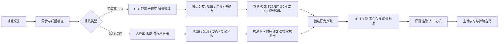

# 计算机视觉自动化检测强迫游泳行为的方法深度研究报告

## 执行摘要

“强迫游泳”在计算机视觉里其实对应两类相当不同的问题：一类是行为神经科学中的啮齿类**强迫游泳实验**（Forced Swim Test, FST），其核心任务是从固定视角视频中自动标注**不动/漂浮（immobility）**，以及在更细粒度方案中标注**swimming** 与 **climbing/struggling**；另一类是监控视频中的**水中遇险/溺水前兆检测**，它在文献里通常不以 “forced swimming” 命名，而是被表述为 drowning detection、aquatic distress detection 或 pool surveillance。两类任务在标签定义、模态选择、实时性要求、伦理与法律约束上都不同，因此任何系统设计都必须先把语义边界说清楚。citeturn10view7turn10view8turn7search4turn0search21

从近十年的方法演进看，实验室 FST 的自动化路线大致经历了三步：先是**阈值/运动学基线**（背景建模、运动能量、光流、面积变化、轮廓/活动阈值）；再到**关键点/姿态驱动**（DeepLabCut、SLEAP、MARS、SimBA、B‑SOiD、VAME、Keypoint‑MoSeq 等）；随后发展到**原始视频直接建模**（2D/3D CNN、I3D、SlowFast、Transformer、3D‑RCNN、DeepEthogram 一类）。对 FST 这种场景稳定、行为集合较小、可解释性要求高的任务，最稳妥的主流工程路线并不是一味追求最重的视频大模型，而通常是“**高质量标注 + 关键点/运动学特征 + 轻量时序模型**”；当数据量足够、跨实验条件泛化要求高时，再上 3D 视频网络或多模态融合才更划算。citeturn17search5turn14view5turn13view0turn13view1turn9view6turn9view11turn9view10

若目标改为泳池/监控视频，最有效的体系通常是“**检测/跟踪 + 时序判别 + 告警规则**”，而不是直接把单帧目标检测当成行为识别。传统 HSV/主动轮廓、光流与背景法依然可作为低成本基线；近年更强的方法多用 YOLO 系检测器、注意力与多尺度特征融合，部分工作已达到接近实用的精度/帧率，但公开数据集依然稀缺，且大量数据来自**模拟溺水**而非真实事故，因此泛化与误报控制仍是核心瓶颈。citeturn10view4turn10view5turn9view4turn27search3turn27search6turn29search1turn30search1turn25search0

本报告的核心建议是：若面向**实验室 FST**，优先选择“**姿态优先**”或“**轻量视频 + 姿态辅助**”路线；若面向**监控/泳池**，优先选择“**检测/跟踪/姿态 + 异常/弱监督时序模型**”路线。无论哪一类，真正决定可用性的不是模型名字，而是**标签本体是否一致、数据划分是否防泄漏、评测是否包含时间鲁棒性与误报成本、以及部署前是否完成跨场景验证**。citeturn34view0turn31search1turn23search8turn23search3turn23search7

## 问题边界与标注标准

在行为神经科学语境里，“强迫游泳”通常指由 entity["people","Roger Porsolt","forced swim researcher"] 在 1970 年代提出的 FST：把鼠类置于**无法触底、无法逃离**的盛水圆筒中，记录其随时间出现的活动与不活动状态。官方/权威报告对 FST 的操作性定义非常一致：这是一种**非自愿、不可逃逸**的水中处置，核心读出是**immobility 的潜伏期与总时长**；而 immobility 常被操作性定义为“漂浮，仅做维持口鼻高于水面的最小动作”。不过，对 immobility 是“behavioral despair”还是“能量保存/应对策略”的解释，学界始终存在争论，这对标签命名和论文表述都会产生影响。citeturn10view7turn10view8turn14view4turn10view9

在监控/泳池语境里，文献更常研究的是**溺水识别、早期遇险识别或异常水中行为检测**，并不把任务正式命名为 “forced swimming”。因此，如果你的目标是“监控视频中识别被迫入水、明显遇险、无法自救的水中行为”，建议在数据集说明与标注手册中弃用含混的 “forced swimming” 字样，改用**aquatic distress / drowning risk / abnormal struggling** 等更可操作的术语，否则会把实验室 FST 与实景安全监控混在一起，导致标签冲突与模型目标漂移。citeturn7search4turn0search21turn27search13

image_group{"layout":"carousel","aspect_ratio":"16:9","query":["mouse forced swim test apparatus", "rodent forced swim test cylinder water", "swimming pool overhead surveillance camera", "underwater swimming pool camera"],"num_per_query":1}

对实验室 FST，我建议采用**三级标签本体**：一级是 `immobility / active` 二分类，适合与历史研究对齐；二级是在 active 内再细分 `swimming` 与 `climbing/struggling`，适合药理分型和机制研究；三级再加 `uncertain / transition / occluded`，用于处理水花遮挡、标注歧义和短暂过渡。现有 FST 论文与指南表明，immobility 是最稳健、最常用的读出，而更细颗粒的 swimming/climbing 更依赖高质量视频与更严谨的人工共识标注。citeturn10view8turn14view4turn13view0

对监控/泳池场景，我建议采用**事件导向标签**而不是静态姿态标签：`normal swimming`、`struggling/distress`、`submersion / missing`、`rescue / intervention`。其中 `distress` 应定义为持续时间不少于若干秒的异常垂直挣扎、局部反复下沉-上浮、前向位移显著减少、头部可见性异常等复合现象；`missing` 则更接近追踪失联/长时间水下不可见。这样更适合视频模型、异常检测与告警逻辑，也更接近现有溺水检测论文的工程实践。citeturn10view4turn10view5turn27search3turn25search20

一个可复现的标注规范，至少应当包含：相机信息、帧率、镜头位置、ROI、标签本体、最小 bout 长度、歧义标签规则、双人复标策略、冲突仲裁流程、导出格式与时间对齐规则。ARRIVE 2.0 强调动物研究必须充分报告实验设计、随机化、盲法、样本与排除标准；把这些要求扩展到行为视频数据集，几乎就是自动化检测系统可复现性的最低门槛。citeturn23search8turn23search4

下表给出两类场景最推荐的标签粒度。

| 场景 | 核心目标 | 推荐标签单位 | 最低可用标签 | 建议扩展标签 | 备注 |
|---|---|---|---|---|---|
| 实验室 FST | 量化不动与应对策略 | 帧级 + bout 级 | `immobility / active` | `swimming / climbing / uncertain` | 最易与历史药理结果对齐；适合做人工-模型一致性分析。citeturn10view8turn14view4turn13view1 |
| 监控/泳池 | 早期告警与事件检出 | 片段级 + 事件级 | `normal / distress / missing` | `submersion / rescue / false alarm source` | 更适合端到端告警与运维。citeturn27search3turn27search6turn25search20 |

## 方法谱系与代表性研究

### 输入模态比较

从工程可行性看，**RGB 视频**仍是默认主模态，因为采集便宜、公开模型多、易部署；**光流**对“是否仍在主动运动”尤其有效，是 immobility/挣扎检测的重要传统模态；**关键点/姿态**在样本少、需要解释性时非常强；**深度/3D 视频**在实验室开放场景里对无监督行为分解很有价值，但在 FST 与泳池中会受到水面反射、折射与透明水体的工程限制，因此实际采用率低于 RGB 或 RGB+关键点。由 entity["organization","Janelia Research Campus","Ashburn, VA, US"] 等团队推动的动物姿态估计工具，已经显著降低了关键点路线的门槛；而 MoSeq/Keypoint‑MoSeq 则说明深度或关键点时序在行为语法建模上很有优势。citeturn9view11turn9view6turn33search8turn34view6turn7search4

| 模态 | 代表用途 | 优点 | 缺点 | 更适合的场景 |
|---|---|---|---|---|
| RGB | 直接视频分类、检测、跟踪 | 信息最全、工具链成熟、迁移学习资源丰富 | 容易受反光、水花、遮挡、照明影响 | FST 与泳池都适用，是默认首选。citeturn9view10turn9view13turn9view14turn9view15 |
| 光流 | immobility/挣扎判别、运动基线 | 对运动变化敏感，配合阈值法很强 | 对波纹、反射、镜头抖动敏感 | 固定机位 FST、泳池水面/水下传统基线。citeturn10view5turn9view10 |
| 关键点/姿态 | 姿态时序、GCN、可解释分析 | 数据效率高、解释性强、跨设备迁移较好 | 水中遮挡和折射下点位易漂移；标注/校对成本存在 | 实验室 FST 优先；监控场景适合作辅助分支。citeturn9view6turn9view11turn9view12turn34view6 |
| 深度/3D | 无监督行为分解、3D动作表征 | 抗纹理噪声、适合行为模块发现 | 涉水场景采集困难，设备限制大 | 非涉水实验室场景更成熟；FST/泳池更多作为研究性模态。citeturn33search8turn33search20 |

### 直接针对实验室 FST 的代表性方法

下表优先列出**直接面向 FST/TST** 的代表性工作。可以看到，FST 直接文献数量并不多，而且“公开视频数据 + 开源代码 + 标准化评测”的工作直到 2024–2025 年才开始明显出现。citeturn17search5turn14view5turn34view1turn34view2

| 方法 | 核心思想 | 输入 | 架构 / 算法 | 训练数据 | 论文报告性能 | 优点 | 局限 | 适用场景 |
|---|---|---|---|---|---|---|---|---|
| 早期运动检测验证（Gao 等，2014） citeturn1search13 | 用视频运动检测替代人工秒表评分 | RGB | 运动阈值/活动量评分 | 小规模 FST 视频 | 论文主旨是“与人工评分一致性验证”，不是深度模型竞赛 | 简单、透明、极易复现 | 依赖阈值；跨实验条件泛化差 | 固定机位、单鼠、只关心 immobility 的基线系统 |
| DBscorer（Nandi 等，2021） citeturn17search5turn17search17 | 开源 GUI；通过校准阈值和视频分析自动量化 immobility、latency、longest bout | RGB | 阈值/面积/活动结构化规则 | 20 个 FST 视频与 20 个 TST 视频做人工对照 | FST 上对 `% immobility`、`latency`、`longest bout` 与人工有良好一致性；例如 `% immobility` 强相关，Bland‑Altman 偏差较小 | 对行为学实验室友好；可解释；学习成本低 | 仍是阈值驱动；对拍摄条件、阈值校准和品系/体色敏感 | 想快速替代人工评分、又不想自己写代码的实验室 |
| DSAAN（Meng 等，2024） citeturn14view5 | “阈值无关”双流网络：少量帧提取形态，差分特征提取运动 | RGB 短片段 | Dual‑Stream Activity Analysis Network | 自建 Mouse FSTST 视频集；仅 94 张标注图也能启动 | FST immobility 识别准确率 88.70%，TST 92.51%；与人工评分高度相关；优于 DBscorer/EthoVision XT 的 Pearson 相关 | 解决阈值主观性；小数据起步能力不错 | 输出仍以 immobility 为核心，细粒度行为与跨实验室泛化证据有限 | 需要快速实现阈值无关的 immobility 自动评分 |
| 3D‑RCNN FST（Della Valle 等，2025） citeturn13view0turn13view1turn13view2turn34view1 | 直接从 3 秒视频张量学习时空动力学，分类 `immobility / swimming / climbing` | RGB 视频 | 3D residual CNN | 自建 FST 视频；Zenodo 公开数据与代码 | 验证集准确率 88.89%；与人工总体视频级准确率 86±4%，Cohen’s κ=0.7809；三类总时长相关：immobility r=0.918、swimming r=0.858、climbing r=0.955 | 直接建模三类 FST 表型；对药理分型更有意义；资源公开较好 | 数据规模仍偏小；对新实验设置的迁移性尚需外部验证 | 需要三分类 FST 表型而不是只算 immobility 的实验室 |

严格说，FST 自动化并不是近十年才出现：更早的 2007–2008 年工作已用高帧率视频、计算机辅助分析和自动分类尝试替代人工评分，说明“**固定机位 + 运动量阈值**”在 FST 里长期是有效基线。真正的变化是，近年方法开始转向**阈值无关、开放源码、可公开复现**。citeturn1search4turn1search7turn17search5turn14view5

### 基于关键点/姿态的方法

关键点路线的优势在于：它把“视频中的外观变化”压缩为“可解释的身体几何与速度学”，因此对小样本、科学解释和跨实验复核尤其友好。**DeepLabCut** 证明，约 200 个标注帧就可以达到接近人工精度的关键点估计；**SLEAP** 则把多动物、多身份、GUI 标注、主动校对等流程工程化；**MARS** 展示了“姿态 + 特征 + 分类器”可以在小鼠行为分类上达到接近人工的水平；**SimBA** 则强调基于姿态的可解释监督学习工作流。citeturn9view6turn9view11turn9view7turn0search11turn3search3

无监督/弱监督方面，来自 entity["organization","Carnegie Mellon University","Pittsburgh, PA, US"] 的 **B‑SOiD**、**VAME** 和 **Keypoint‑MoSeq** 构成了目前最有代表性的“从姿态到行为语法”的工具链：B‑SOiD 用无监督聚类发现行为原子，再用监督分类快速外推；VAME 用变分嵌入发现分层行为模体；Keypoint‑MoSeq 则显式建模关键点噪声与亚秒级动作边界。对 FST 而言，这些方法尤其适合做**新型行为原语发现**、**药物或品系差异挖掘**，或为后续监督分类构造更好的标签本体。citeturn9view8turn34view7turn34view6

若进一步做时序动作识别，**ST‑GCN** 及其后续 skeleton‑GCN 变体依然是姿态时序建模的经典起点。它的价值不在于它一定是 FST 最强，而在于它天然适合把“鼻尖、四肢、躯干、尾根”等关键点的空间拓扑与时间变化共同编码，对于区分 immobility 与低幅度主动动作，比单帧姿态更可靠。citeturn9view12

| 方法 | 核心思想 | 输入类型 | 训练数据 | 论文报告性能 | 优点 | 缺点 | FST 适配性 |
|---|---|---|---|---|---|---|---|
| DeepLabCut（2018） citeturn9view6turn3search16 | 少量标注帧 + 迁移学习的无标记姿态估计 | RGB → 关键点 | 研究者自定义标注帧，约 200 帧可起步 | 测试帧精度接近人工 | 高数据效率、生态成熟、适合单鼠实验 | 多动物/遮挡下需额外处理 | **高**：适合做 FST 姿态前端 |
| SLEAP（2022） citeturn9view11turn36search0 | 多动物姿态与身份跟踪一体化 | RGB → 关键点/ID | 用户自标注帧 | 论文强调多动物和工作流工程化 | GUI 完整、多模型、可校对 | 学习曲线略高于 DLC | **高**：当 FST 之外还要兼容多动物实验时更优 |
| MARS（2021） citeturn9view7turn3search13 | 姿态 + 行为特征 + 分类器的端到端小鼠行为管线 | RGB/关键点 | 配套姿态与注释数据已公开 | 行为分类与姿态估计达到 human‑level | 端到端鼠类工作流成熟 | 原始任务偏社交行为，不是 FST 专用 | **中高**：适合作为“姿态后、分类前”的工程参考 |
| SimBA（2024 技术报告） citeturn0search11turn3search3 | 基于关键点与随机森林的可解释监督分类 | 关键点/ROI/运动特征 | 用户自建行为标签 | 文献强调可解释性与大规模行为分类 | 快速原型、解释强 | 对特征工程与标签质量敏感 | **高**：非常适合 FST 小样本监督分类 |
| B‑SOiD（2021） citeturn9view8turn36search2 | 无监督行为发现 + 快速监督预测 | 关键点时序 | 无需行为标签起步 | 侧重发现行为模块而非固定类别精度 | 能发现人工未预设的行为模式 | 输出簇需要人工语义化 | **高**：适合发现 FST 过渡状态/新运动模体 |
| VAME（2022） citeturn34view7turn33search0 | 变分嵌入发现层级行为结构 | 关键点时序 | 无监督 | 发现层级化行为模体 | 适合机制研究与群体比较 | 不是直接的在线分类器 | **中高**：适合科学发现，不是首选部署模型 |
| Keypoint‑MoSeq（2024） citeturn34view6turn33search19 | 在关键点噪声与真实行为之间建立生成模型 | 关键点时序 | 无监督 | 自动发现亚秒级 “syllables” | 对行为语法、过渡、微动作很强 | 对工程部署不如监督分类直接 | **中高**：适合高分辨行为解析和标签扩充 |
| ST‑GCN（2018） citeturn9view12 | 图卷积学习关键点拓扑与时间演化 | 关键点骨架序列 | 常见做法是大数据预训练 + 小数据微调 | 在 NTU/Kinetics 骨架任务上显著优于前代 | 时序表达强、与姿态前端衔接自然 | 关键点误差会向后传递 | **高**：适合作为 FST 姿态时序分类器 |

### 基于深度学习的视频方法

如果不想显式做关键点，直接从视频像素建模的路线就是 2D/3D CNN、双流网络、SlowFast 和 Transformer。**I3D** 把 2D 卷积“膨胀”成 3D 卷积，是很多小数据视频任务的经典初始化方式；**TSN** 利用稀疏时间采样建模长时依赖，计算更省；**SlowFast** 用慢快双路径分别编码语义与快速运动，非常适合像游泳/挣扎这类时间动态明显的行为；**TimeSformer** 与 **Video Swin Transformer** 则把时空注意力引入视频理解，通常在大预训练数据时更强。citeturn5search0turn9view13turn9view14turn9view15turn9view16

对 FST 来说，视频大模型的真正优点在于：它不需要你事先决定哪些关键点最重要，也能直接吸收水体纹理、体姿、轨迹与微动作等复合线索。问题是，FST 的公开数据规模远小于 Kinetics 一类通用视频集，因此**预训练 + 小样本微调**几乎是必需的；否则模型很容易学到“某个实验室的桶、灯光、水面反射”而不是行为本身。2025 年的 3D‑RCNN FST 工作已经说明，公开视频张量 + 3D 视频模型确实可行，但更重的 SlowFast/Transformer 是否值得上，取决于你是否真的拥有跨批次、跨品系、跨相机的大样本数据。citeturn13view0turn13view2turn34view1turn9view14turn9view15turn9view16

| 模型家族 | 代表作 | 典型输入 | 典型训练范式 | 公开报告性能 | 优点 | 缺点 | FST 适配性 |
|---|---|---|---|---|---|---|---|
| 稀疏 2D 视频模型 | TSN（2016） citeturn5search0turn19search7 | RGB / RGB+Flow | ImageNet/视频预训练 + 小数据微调 | UCF101 94.2%，HMDB51 69.4% | 计算便宜、长视频采样友好 | 对微动作局部动态不如 3D 模型 | **中高**：适合轻量长时建模 |
| 3D CNN | I3D（2017） citeturn9view13 | RGB / Flow | Kinetics 预训练 + 微调 | HMDB51 80.9%，UCF101 98.0% | 通用、稳健、迁移成熟 | 参数与算力开销较大 | **高**：数据够时非常强 |
| 双速率视频模型 | SlowFast（2019） citeturn9view14turn19search11 | RGB | Kinetics 预训练 + 微调 | PyTorchVideo Hub 上 Kinetics top‑1：R50 76.94%，R101 77.90% | 对快速运动模式特别友好 | 部署比 TSN/I3D 更重 | **高**：非常适合主动游动/挣扎时序 |
| 纯 Transformer | TimeSformer（2021） citeturn9view15turn19search21 | RGB patch 序列 | 大预训练更有利 | 原文在视频基准上达到强性能 | 长程依赖能力强 | 小数据下容易不稳，推理成本高 | **中**：除非数据大，否则不如 pose/3D CNN 划算 |
| 局部窗口 Transformer | Video Swin（2022） citeturn9view16turn6search14 | RGB | 图像预训练 + 视频微调 | 原文强调效率/精度权衡优于更全局的视频 Transformer | 精度/效率折中较好 | 仍偏重，部署门槛高 | **中高**：若追求更强泛化可考虑 |
| 原始像素行为学管线 | DeepEthogram（2021） citeturn9view10turn36search1 | RGB 视频 | 少量行为标签监督 | 多数据集上帧级行为常 >90%，接近专家 | 不必先做关键点；GUI 完整 | 对严重视角变化和域移敏感 | **高**：适合做 FST 的原始像素监督基线 |

### 监控/泳池场景的代表性方法

由于泳池/监控任务的目标是“尽早发现异常并及时告警”，其方法评价不能只看分类精度，还必须看**误报率、漏报率、速度、视角鲁棒性与部署约束**。这一方向比 FST 更贴近目标检测/行为告警工程。citeturn7search4turn27search13

| 方法 | 核心思想 | 输入 | 架构 / 算法 | 训练数据 | 论文报告性能 | 优点 | 局限 | 适用场景 |
|---|---|---|---|---|---|---|---|---|
| Salehi 等（2016） citeturn10view4 | HSV 颜色空间 + 主动轮廓 + 缺失告警 | 俯视 RGB | 传统图像处理 | 自录泳池视频 | 主打实时检测，不是大规模学习评测 | 便宜、可嵌入、可解释 | 环境依赖强，对复杂水面鲁棒性有限 | 资源极弱、固定泳池、低成本报警 |
| Chan 等（2013） citeturn10view5 | 密集光流 + 周期图 + GMM 强调“swimmer vs ripple” | RGB | 光流/背景建模 | 泳池视频 | 强调 swimmer detection 的有效性 | 传统运动学对水体有针对性 | 是检出不是完整告警链 | 作为 motion baseline 很有价值 |
| Lei 等（2022）BR‑YOLOv4 citeturn9view4turn29search7 | 水下多机位 + 改进 YOLOv4 行为识别 | 水下 RGB | 定制 YOLOv4 | 自建两类数据（swimming / drowning） | 文献转述 mAP：YOLOv4 约 92.41%，YOLOv5 约 90.32% | 已接近工程化，多角度考虑 | 高密度泳池、小目标和反光仍难 | 水下固定多机位泳池 |
| He 等（2023）YOLOv5s vs Faster R‑CNN citeturn27search3 | 婴儿泳池视频目标检测 | RGB 监控视频 | Faster R‑CNN / YOLOv5 系列 | 多家泳馆实景数据 | mAP 均可超 89%；Faster R‑CNN 约 6 FPS、precision 62.04%；YOLOv5s 约 75 FPS、precision 86.6% | 给出清晰速度-精度权衡 | 主要是检测，不是完整长时行为分析 | 实时初筛、边缘端较友好 |
| He 等（2023）两阶段注意力 YOLOv5‑like + SSD citeturn27search6turn27search11 | 先抠婴儿前景，再二阶段识别泳姿/危险状态 | RGB | 注意力 YOLOv5-like + SSD | 十个泳池训练、两个泳池测试；总计 7296/7723 图像 | mAP 97.17%，43 FPS | 兼顾速度与精度，适合小目标婴儿 | 场景较专、需两阶段维护 | 婴儿泳池与单一设施 |
| Yang 等（2023）改进 YOLOv5 citeturn29search1 | ICA + BiFPN 提升小目标与水中姿态检测 | RGB / 无人机俯视 | 改进 YOLOv5 | 8572 自建图像 | precision 98.1%、recall 98.0%、mAP 98.5% | 精度很高 | 数据来自模拟/自建；外部泛化待证 | 俯视场景、对无人机/高位摄像头友好 |
| Zhang 等（2025）YOLO11‑LiB citeturn30search1turn30search0 | 轻量化 YOLO11，多尺度与边缘部署折中 | RGB | YOLO11n 改进版 | 自建泳池数据 | DmAP50 94.1%，2.02M 参数；检索摘要称模型小、轻量 | 边缘部署友好 | 仍以自建数据为主，规范 benchmark 缺乏 | 边缘 GPU/嵌入式泳池监控 |

### 多模态融合、异常检测与弱监督/无监督

多模态融合可以分成三层。**早融合**是把 RGB、光流、深度或 pose heatmap 一起喂进网络；**中融合**是在双流/多流网络的中间层做特征交互；**后融合**则是把“检测器、跟踪器、姿态分支、规则引擎、异常分数”在决策层合并。FST 直接文献里，中融合或多模态融合还不算多见，DSAAN 的“双流形态 + 差分运动”是最接近的例子；但在监控场景，检测 + 跟踪 + 时序异常分数的后融合更常见，也更容易务实落地。citeturn14view5turn19search9turn7search4

在弱监督/无监督方向，若你几乎没有逐帧标签，可以把问题改写为**异常检测**或**行为模体发现**。针对动物行为，B‑SOiD、VAME、Keypoint‑MoSeq、MoSeq 都能从姿态序列中自动发现重复行为模块；针对监控视频，弱监督视频异常检测通常只需要视频级标签，或者只用正常样本学习“normality”，再把偏离模式判为异常。Transformer 和视觉语言模型近年来已明显进入该方向，例如弱监督时序判别 Transformer、CLIP/VadCLIP/STPrompt 一类方法，都在减少精细标注成本。对于“强迫游泳/遇险行为”这种**稀有、定义会变、人工标注代价高**的问题，这条路尤其值得做成第二赛道，而不是只做一套全监督分类器。citeturn9view8turn34view7turn34view6turn31search1turn32search8turn32academia20turn32search15

## 数据、标注工具与评测

### 数据集现状与可用资源

就我本次检索能明确确认到的资源而言，**直接面向 FST 的公开数据仍然很少**。可明确公开获取并附带代码的，主要是 2025 年 3D‑RCNN FST 工作随 Zenodo/GitHub 公开的数据与代码；2024 年 DSAAN 论文则报告了自建 **Mouse FSTST** 数据集，但检索结果里主要能确认到数据集名称与实验细节，尚未看到像 MABe22 那样成熟的社区 benchmark 入口。换句话说，FST 领域目前仍然是“**论文各自建集、各自评测**”的状态。citeturn34view1turn34view2turn14view4

作为迁移学习和预训练资源，可利用的动物行为/姿态公共数据要丰富得多：**AP‑10K** 是通用动物姿态估计基准；**Animal Kingdom** 覆盖 850+ 物种、动作识别/视频 grounding/姿态多个任务；**MABe22** 提供跨物种、多任务、千万级帧规模的行为表示学习 benchmark。它们虽然不是 FST 数据集，但对于构造稳健的姿态前端、学习行为表征、检验跨域泛化非常有价值。citeturn34view5turn24search3turn34view4turn34view3

合成数据方面，**replicAnt** 说明了一个重要现实：在动物视觉任务中，合成数据可以显著减少手工标注，用于检测、跟踪、姿态和分割的预训练都有效。对于 FST，这意味着你完全可以先用合成或半合成水桶场景训练“鼠体检测/关键点初模”，再用少量真实视频微调；对泳池监控而言，也可以通过风格扰动、波纹/反光模拟、3D 人体/泳姿仿真来补足稀缺的危险样本。citeturn20search2turn20search8

在监控/溺水方向，公开数据也仍不理想。近年能确认的一个公开数据源是 2025 年的 **Underwater Drowning Detection Dataset**，包含 5613 张水下图像、三类状态 `swimming / struggling / drowning`，并给出 YOLO 格式标注与基线结果；但这类数据多来自**受控环境与模拟场景**，距离真实室外泳池、自然水域和复杂人群密度还有明显差距。citeturn25search0

### 标注工具与开源工具链

手工标注阶段，**BORIS** 仍是行为学视频打标签的经典工具，因为它天然支持事件日志与 ethogram；若你要做更现代的视频/边界框/关键点标注，**CVAT** 与 **Label Studio** 更适合团队协作和模型辅助预标。对姿态后处理与行为分类，**BehaviorDEPOT**、**SimBA**、**DeepEthogram**、**MARS**、**DBscorer** 构成了从规则法、姿态法到原始视频法的一整套开源生态，而 2023 年综述也确认了这些开源工具在算法机制、界面、输出粒度和适用实验上差异很大，选型必须与任务定义绑定。citeturn22search8turn22search5turn22search18turn36search3turn3search3turn36search1turn3search13turn17search17turn34view0

### 评价指标与基准建议

实验室 FST 若只做二分类/三分类，不建议只报一个 accuracy。最应报告的是：**帧级 accuracy / macro‑F1**、**Cohen’s κ**（衡量与人工一致性）、**行为总时长的 Pearson/Spearman 相关**、以及对 `% immobility`、`latency to immobility`、`longest bout` 的 Bland‑Altman 一致性分析。DBscorer 与 3D‑RCNN FST 都明确表明，只看分类正确率会掩盖真正重要的行为读出偏差。citeturn17search5turn13view1turn13view2

监控/泳池任务则必须把**检测指标**与**告警指标**分开。检测侧至少报 `mAP@50`、`precision`、`recall`、`F1`、`FPS`；告警侧则建议增加**平均告警延迟**、**每小时误报数**、**每泳道/每画面误报率**、**time‑to‑alert** 和 **跨视角泛化**。原因很简单：一个 95% mAP 的模型，如果每小时误报几十次，实际上不能部署。YOLO 体系的评测文档与多篇溺水检测论文都说明，速度与精度必须一起讨论。citeturn30search24turn27search3turn27search6turn30search1

我建议未来 FST 研究的“最小可发表基准”至少包括四件事：同实验室 hold‑out、跨批次 hold‑out、跨相机/桶具 hold‑out、跨药物/品系 hold‑out。若任一设置下性能显著下滑，就不能把模型称为“自动化行为学评分器”，最多只能称为“某实验配置下的辅助评分器”。这也是为什么我更推荐使用动物级、视频级、实验批次级的严格划分，而不是随机帧划分。这个建议与 ARRIVE/可复现行为学文献的精神是一致的。citeturn23search8turn34view0

下表汇总我建议优先纳入的开源资源，所有项目均优先给出官方或原始来源。

| 资源 | 类型 | 主要用途 | 适合阶段 |
|---|---|---|---|
| DeepLabCut citeturn3search16turn9view6 | 代码库 | 单/多动物关键点估计 | FST 姿态前端、少样本启动 |
| SLEAP citeturn36search0turn9view11 | 代码库 | 多动物姿态与身份跟踪 | 多摄像头/多动物实验 |
| MARS citeturn3search13turn9view7 | 代码库+数据 | 小鼠姿态与行为分类管线 | 姿态后行为分类参考 |
| SimBA citeturn3search3turn0search11 | 代码库 | 姿态特征 + 可解释行为分类 | FST 小样本监督分类 |
| DeepEthogram citeturn36search1turn9view10 | 代码库 | 原始视频到帧级行为 | 原始像素监督基线 |
| B‑SOiD citeturn36search2turn9view8 | 代码库 | 无监督行为发现 | 行为原子/标签本体发现 |
| Keypoint‑MoSeq citeturn33search19turn34view6 | 代码库 | 关键点无监督行为语法 | 微动作与行为语法挖掘 |
| DBscorer citeturn11search1turn17search17 | 代码库 | FST/TST 阈值自动评分 | 临床前实验室快速替代人工 |
| FST_3DRCNN + Zenodo 数据 citeturn34view2turn34view1 | 代码+数据 | FST 三分类视频模型 | 直接复现实验 |
| BORIS citeturn22search8turn22search0 | 标注工具 | 行为事件日志与 ethogram | 人工基准标注 |
| CVAT citeturn22search5turn22search17 | 标注工具 | 视频/框/关键点标注 | 团队标注协作 |
| Label Studio citeturn22search18turn22search2 | 标注工具 | 多模态标注与预标注 | 中大型标注工程 |
| AP‑10K citeturn24search1turn34view5 | 数据集 | 通用动物姿态预训练 | 姿态前端预训练 |
| Animal Kingdom citeturn24search3turn34view4 | 数据集 | 动作识别/姿态/grounding | 动物行为表示学习 |
| MABe22 citeturn24search2turn34view3 | 数据集 | 多物种多任务行为表征 | 自监督/表示学习 |
| replicAnt citeturn20search2turn20search8 | 合成数据管线 | 生成动物视觉训练数据 | 数据稀缺时的预训练 |
| MMAction2 citeturn4search9turn19search0 | 视频工具箱 | TSN/I3D/SlowFast/Transformer 复现 | 视频模型研发 |
| PySlowFast / PyTorchVideo citeturn19search8turn19search22 | 视频工具箱 | SlowFast/X3D/MViT 等 | 高性能视频建模 |
| Anomalib citeturn34view8turn34view9 | 异常检测库 | 图像/视频异常检测 | 监控弱监督/无监督支线 |

## 工程实现与部署建议

### 建议的系统方案

如果没有额外约束，我的首选方案不是单一模型，而是**分层系统**：先做视频标准化、ROI 定位和质量控制；再按资源条件选择“规则基线 / 姿态前端 / 视频时序模型”；最后做时序平滑、事件合并、人工复核与主动学习回流。这样设计的原因是，FST 和泳池监控都高度依赖**时间连续性**，而不是单帧图像。citeturn34view0turn31search1turn35search1

上面的流程图对应三种最推荐的工程落地路线。第一，**实验室 FST 标准版**：`DeepLabCut/SLEAP → 关键点速度/角度/肢体幅度 → TCN 或 ST‑GCN → 概率平滑`。它最平衡可解释性、样本效率与论文可复核性。第二，**实验室 FST 视频增强版**：在上面基础上并联 `3D‑RCNN / I3D / SlowFast`，只在关键点模型信心低或需要细分 swimming/climbing 时调用。第三，**泳池监控版**：`YOLO 类检测器 → 跟踪 → pose/flow 辅助 → 异常检测或短片段分类 → 告警规则`。citeturn9view6turn9view11turn9view12turn13view0turn9view14turn27search3turn30search1
