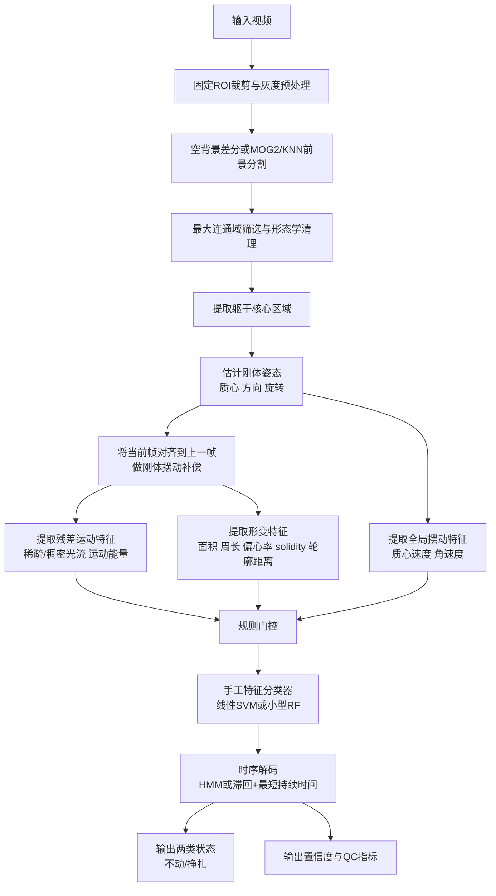

# 小鼠悬尾实验传统计算机视觉自动评分方案调研与推荐设计

## 执行摘要

你要做的其实不是普通的“运动检测”，而是一个在**单视角、强自遮挡、被动摆动显著**的场景里，把“**主动挣扎导致的非刚体内部运动**”与“**被尾吊引起的整体被动摆动/躯干旋转**”区分开的二分类问题。公开资料显示，DBscorer 这类方法的核心是比较连续帧中**二值化轮廓面积变化的百分比**，再按秒平均后阈值化；它在 TST 场景里确实容易把**细微肢体运动**判成不动，把**被动摆动或躯干旋转**误判成挣扎，而且 2026 年 iMOSS 论文还明确指出 DBscorer 的**有效时间分辨率只有 1 Hz**，这会进一步丢失短促挣扎和状态切换信息。换句话说，你“感觉它完全用不了”，和公开文献指出的问题是高度一致的。citeturn32search0turn3view3turn2view2turn3view0

如果坚持不用深度学习，我不建议继续走“**前景面积变化 + 单阈值**”这一路线。更适合 TST 的方案应当是一个**多模块传统 CV 流水线**：先做**稳定前景分割**，再做**刚体摆动补偿**，把整体平移/旋转尽量消掉，然后在补偿后的 ROI 上提取**残差运动特征**、**局部光流特征**、**轮廓/形变特征**和**短时运动能量特征**，最后再用**规则门控 + 手工特征分类器 + 时序模型**来稳定输出。这个思路直接针对 iMOSS 指出的两类关键误判来源：一类是“有轻微主动动作但轮廓变化不大”，另一类是“没主动动作但整只鼠在摆”。citeturn2view2turn3view0turn31view2

就速度与精度的平衡而言，如果目标未指定，我建议同时准备三档配置。**实时 30 fps** 优先选“**前景分割 + 刚体补偿 + 稀疏光流 + 少量轮廓特征 + 双阈值/小型线性 SVM + 因果平滑**”；**近实时 10 fps** 可以升级为“**稠密 Farnebäck 光流 + 更完整的形变特征 + HMM**”；**离线分析** 则再加入“**时间窗统计、MHI、模板/关键点辅助模块和更强的时序解码**”。OpenCV 官方文档提供了 MOG2/KNN、PyrLK、Farnebäck 以及 CUDA 加速版本；ToxTrac 论文摘要和项目资料也表明，传统方法在现代桌面机上做到 **HD 视频 >25 fps** 是现实可达的，但鲁棒性高度依赖背景、光照和 ROI 设计。citeturn27view3turn27view2turn28view2turn38view0turn26search1turn9search17turn36view0

我的核心推荐是：**不要把“是否发生了像素变化”当作主判据，而要把“在消除了整体摆动之后，是否还存在显著的内部非刚体残差运动”当作主判据**。在单视角纯视频条件下，这通常比 DBscorer、直接套 ezTrack FreezeAnalysis、或者仅用 centroid/面积阈值的方案更接近你要的“高准确率 + 强鲁棒性 + 基本实时”。如果采集条件做得好、阈值标定得当，并允许少量人工标注来训练一个小型传统分类器，**片段级 F1 做到大约 0.88–0.95** 是合理目标；若完全零标注、只靠规则，一般更现实的目标会落在 **0.80–0.90** 左右，而且对不同实验日、不同毛色和不同视角的泛化会明显变差。这里的区间是工程估计，不是公开 benchmark。支撑这一判断的，是 TST 场景公开文献对视频法局限的描述、DBscorer/ezTrack/ToxTrac 等开源实现的机制，以及经典传统 CV 算法的计算特性。citeturn2view2turn3view0turn31view2turn9search17turn24view2

| 目标档位 | 推荐配置 | 主要优点 | 主要代价 |
|---|---|---|---|
| 实时 30 fps | 静态背景/轻量 MOG2 + 刚体补偿 + 稀疏 PyrLK + 低维手工特征 + 滞回阈值或线性 SVM + 因果平滑 | 延迟低，CPU 友好，工程实现最稳 | 对极细微肢体动作的敏感度略逊 |
| 近实时 10 fps | 轻量分割 + 刚体补偿 + 稠密 Farnebäck + 轮廓形变 + HMM | 对短促挣扎和微运动更敏感，鲁棒性更高 | 计算量明显上升 |
| 离线 | 全部分量特征 + MHI/时间窗统计 + 模板或传统关键点辅助 + Viterbi/HSMM | 精度上限最高，易做消融和 QA | 不适合在线闭环 |

上表的速度分档与模块增减，是结合 OpenCV 的算法实现方式、ToxTrac 的公开速度信息以及 TST 的固定机位特征给出的工程建议。citeturn27view2turn28view2turn38view0turn9search17

## 场景约束与输入数据要求

在 TST 中，行为学上最关键的定义不是“画面有没有动”，而是“有没有**主动逃逸相关动作**”。公开 TST 文献与 protocol 都把测试描述为在悬吊下交替出现**主动挣扎**与**被动不动**；而 2026 年 iMOSS 论文特别指出，视频法的主要错误之一，是把**局部细微运动**漏掉，或者把**被动摆动/躯干旋转**当成主动运动。对你的算法而言，这意味着标签定义必须写清楚：**不动**应定义为“无主动逃逸动作”，**挣扎**定义为“存在主动逃逸相关的躯干或肢体动作”；**被动摆动不应算挣扎**。不同实验室对“不动”最小时长的定义并不完全一致，公开 protocol 有用 **≥1 s** 的，也有软件端允许用户把该阈值设成 1–2 s 甚至更高，因此这应当作为显式超参数，而不是写死在代码里。citeturn2view2turn20view0turn3view3

| 项目 | 用户当前信息 | 建议输入要求 | 说明 |
|---|---|---|---|
| 视频分辨率 | 未指定 | **推荐采集** 1280×720 或 1920×1080；**推荐处理**时仅保留单鼠 ROI 并降到长边 512–800 像素 | 采集高分辨率有利于细微肢体动作；处理时裁 ROI 才能保实时 |
| 帧率 | 未指定 | **推荐采集** 30 fps；若希望看清短促挣扎或肢体 flick，优先 50–60 fps；若算力紧张，分析时可降到 10–30 fps | ToxTrac 文档指出 25 fps 对多数实验够用，但快运动时应更高 |
| 摄像机视角 | 未指定 | 固定机位、单鼠单视野、镜头不晃动；优先正侧之间的**轻微斜侧视角**，保证前后肢尽量可见 | 单纯正背/正腹视角更容易把肢体藏进躯干轮廓 |
| 背景与光照 | 未指定 | 哑光、均匀、与毛色高对比；避免反光、阴影、亮斑；每天录 5–10 s 空背景标定视频 | 这是传统算法鲁棒性的决定性条件 |
| 是否需要标注 | 未指定 | **规则版** 可 0 标注启动，但建议仍做少量人工标定；**分类器版** 需要标注 | 要高准确率，少量高质量标注很值 |
| 样本量建议 | 未指定 | 规则版：先人工审看 3–5 个视频做阈值标定；分类器版：建议 20–40 个开发视频，另留 15–20 个独立测试视频；若条件允许，覆盖不同实验日/毛色/药物组 | 重点是覆盖“域变化”，不是只堆帧数 |
| 数据采集扩增 | 未指定 | 真实扩增：跨实验日、跨操作者、跨毛色、跨背景亮度、跨药物状态采集；合成扩增：亮度/对比度扰动、轻微模糊、压缩、丢帧、微小仿射抖动，仅用于鲁棒性测试与阈值耐受性分析 | 传统算法更吃采集规范与域覆盖 |

这些要求并不是“越高配越好”，而是尽量与传统 CV 的工作方式对齐。IMPC 的 TST protocol 明确要求**单鼠单相机、固定背景、针对毛色调整检测参数、每天录制无鼠背景视频**；ToxTrac 的官方录制建议强调**高对比、均匀背景、尽量无反射和阴影**，并指出 25 fps 对多数实验足够，但快运动时应更高；DBscorer 的 README 也提醒要用**无眩光、无阴影、非反光背景**并尽量裁紧 ROI。citeturn7view1turn36view0turn2view1

关于标注，我建议采用“两层策略”。第一层是**阈值标定标注**：像 DBscorer 一样，先人工看 3–4 个视频求一个初始阈值范围；第二层是**少量监督标注**：如果你允许用传统机器学习（SVM / RF），就再做 20–40 个视频的帧级或短窗级标注。JAABA 的经典论文和官方文档都强调，行为分类器可以从**少量人工标注帧**起步，但泛化能力取决于训练样本是否覆盖目标行为的多样性；对 TST 来说，多样性主要来自毛色、姿态、自遮挡程度、药物处理导致的活动模式差异，以及不同实验日的背景/光照漂移。citeturn24view0turn24view1turn3view3

还有一个经常被忽略但实际影响很大的问题是**尾爬**。公开 protocol 和文献都强调要使用塑料 cone 或 tube 防止 tail climbing，因为一旦出现尾爬，TST 的状态定义本身就被破坏了；而且 C57BL/6 背景小鼠在一些研究里尾爬比例并不低。对算法来说，尾爬应被视为**QC 失败**而不是简单地强行归入“挣扎”。citeturn7view1turn18view1

## 传统方法调研与比较

### 为什么 DBscorer 类方法在 TST 里容易失效

DBscorer 的思想并不复杂：把目标二值化，计算当前帧相对前一帧的**二值面积变化百分比**，再按秒平均；低于阈值就算 immobile。这个设计对某些“整体运动即行为”的实验还凑合，但在 TST 里恰好避开了真正困难的部分。因为 TST 的关键矛盾不是“鼠有没有移动位置”，而是“**是否存在主动产生的内部运动**”。当鼠被动摆动时，画面里轮廓会明显移动；当只有局部肢体轻微挣扎且恰好被躯干遮挡时，轮廓面积变化又可能很小。iMOSS 2026 的讨论几乎就是对这一点的直接点名：DBscorer 和 EthoVision 这类视频算法通常依赖灰度或二值面积差分，因此容易把**被遮挡的局部肢体运动**判成 immobility，又把**被动摆动或躯干旋转**判成 mobility。citeturn32search0turn2view2turn3view0

你如果只靠“变化像素数”和“一条阈值线”，实际上会把以下几类不同现象混为一谈：**整体平移**、**整体旋转**、**局部肢体抖动**、**轮廓形变**、**阴影漂移**和**背景闪烁**。ezTrack 的 FreezeAnalysis 虽然比 DBscorer 更规范，提供空场景校准、Gaussian 去噪、最小时长等机制，本质上仍然是在数“连续帧间超过阈值的像素数”；它很适合以“无运动”为核心定义的 freezing 场景，但如果直接搬到 TST，仍会被被动摆动困扰。citeturn31view1turn31view2

### 候选传统方法比较

| 方法 | 核心判据 | 对 TST 的适配性 | 噪声/遮挡/光照鲁棒性 | 计算成本 | 实现难度 | 预期片段级 F1 区间 | 鲁棒性评分 |
|---|---|---|---|---|---|---|---|
| 纯帧差 / 变化像素计数 | 连续帧灰度差、 changed pixels | 中下 | 对阴影、抖动、摆动敏感 | 低 | 低 | 0.65–0.82 | 2/5 |
| 背景建模 + 面积阈值 | 前景面积、 object area change | 中 | 对背景稳定性要求高；对被动摆动敏感 | 低 | 低 | 0.70–0.85 | 2.5/5 |
| 稀疏光流 | 少量特征点位移 | 中上 | 对遮挡比面积法更好，但点选取会漂 | 低到中 | 中 | 0.75–0.88 | 3/5 |
| 稠密光流 | ROI 每像素位移场 | 上 | 对细微运动敏感，但受噪声和全局摆动影响 | 中到高 | 中 | 0.78–0.90 | 3.5/5 |
| 运动能量 / MHI | 短窗内运动时空模板 | 上 | 对短时行为成团表达较好，但不能天然区分主动/被动 | 中 | 中 | 0.78–0.90 | 3.5/5 |
| 轮廓/形状特征 | 周长、偏心率、solidity、形变距离 | 上 | 对光照较稳，但分割一旦差就会崩 | 低到中 | 中 | 0.72–0.88 | 3/5 |
| 传统关键点 / 模板 / HOG+SVM | 部件位置、姿态变化 | 中 | 对自遮挡和视角变化脆弱；但可做辅助模块 | 中到高 | 高 | 0.70–0.87 | 2.5/5 |
| 手工特征 + SVM / RF / AdaBoost | 多特征融合做窗口级判别 | 上 | 取决于特征设计和训练覆盖面 | 低到中 | 中 | 0.82–0.92 | 4/5 |
| 规则 + HMM / CRF / DTW | 时序平滑、模板匹配、状态转移 | 上 | 对单帧噪声有帮助 | 低到中 | 中 | 0.83–0.93 | 4/5 |
| **推荐混合方案** | **刚体摆动补偿 + 残差运动 + 形变 + 时序模型** | **最高** | **直接针对 TST 两大误差源** | **中** | **中到高** | **0.88–0.95** | **4.5/5** |

上表中“预期片段级 F1 区间”“计算成本”“鲁棒性评分”是基于公开文献、官方文档和单鼠固定相机 TST 场景做出的**工程估计**，不是同一数据集上的标准化 benchmark。背景建模参考了 OpenCV 的 MOG2 和 KNN 文档，以及 ViBe 的经典论文与后续综述；光流参考了 Farnebäck 与 OpenCV 的 PyrLK/Farneback 实现；运动模板参考了 Bobick 与 Davis 的时间模板工作；传统部件/关键点参考了 HOG 与 flexible mixtures of parts；手工特征分类与行为标注参考了 JAABA；开源行为软件层面的可用性与限制，则参考了 DBscorer、ezTrack、ToxTrac 和近年的 rodent open-source 软件综述。citeturn27view3turn28view1turn14search16turn14search13turn28view2turn27view2turn13search1turn13search3turn11search14turn21search1turn24view0turn24view1turn32search0turn31view2turn9search17turn24view2

从 TST 的特殊性出发，我对这些方法的判断是这样的。**背景建模/差分**适合作为“第一层感知”，负责把鼠从背景里抠出来，但不适合直接做最终判别；**光流**是最值得用的核心运动表征，但必须先做刚体摆动补偿，否则会把整只鼠的摆荡当成挣扎；**运动能量/MHI**很适合作为短时间窗的补充，因为它能把“动作是局部突然爆发，还是低频连续摆动”编码出来；**轮廓/形状特征**对被动摆动与主动形变的区分尤其有价值，因为不动时更多是整体刚体运动，而挣扎通常伴随轮廓扭曲、躯干弯曲和下肢区域形变；**传统关键点法**理论上可行，但单视角 TST 的自遮挡太重，不适合做主轴，只适合做离线增强或歧义片段复核；**HMM/半马尔可夫模型**在这里比 CRF 更“够用”，因为你只有两个状态，真正需要的是把单帧噪声压掉并引入最短持续时间约束。citeturn2view2turn31view2turn28view2turn13search3turn27view1turn11search7turn15search4

如果一定要拿现成开源方法做基线，我建议至少做三条。第一条是 **DBscorer V2**，用作者推荐的 TST 初值阈值 0.6，再按其说明用 3–4 个视频手动校正；第二条是 **ezTrack FreezeAnalysis 改造版**，把 freezing 直接替换成“低运动”并调整 ROI 与最小时长；第三条是 **ToxTrac + 自定义后处理**，先只利用它的前景/轨迹，再在轨迹和分割结果上计算你自己的判别特征。这样对比最公平，因为三者都属传统视觉/非深度学习生态，但它们对 TST 的匹配度差异很大：DBscorer 更像“面积阈值工具”，ezTrack 更像“变化像素计数工具”，ToxTrac 更像“高性能目标分割/跟踪底座”。citeturn3view3turn31view2turn36view0turn36view1

## 推荐算法流水线

### 设计原则

我建议的主线思路可以概括成一句话：**先把“整只鼠被动摆动”的成分减掉，再看还剩下多少真实内部运动与轮廓形变。** 这和 DBscorer、EthoVision 一类“面积变化即活动”的假设不同，也比直接数 changed pixels 更接近 TST 的行为定义。这个设计之所以合理，是因为公开文献已经把 TST 视频法的主要错误来源说得很清楚：细微肢体动作会被躯干遮挡，而被动摆动和躯干旋转又会在 2D 画面中制造大量并非主动挣扎的表观运动。citeturn2view2turn3view0



上图的关键不是“模块多”，而是**模块之间的职责被拆开**了：分割负责找鼠，刚体补偿负责消摆动，特征层负责看“补偿后还剩什么”，时序层负责把瞬时噪声压平。这样的结构更适合工程调试，也更容易做消融。citeturn27view3turn28view2turn31view2

### 预处理、分割与刚体摆动补偿

在 TST 这种固定机位场景，如果你每天都能录一小段**空 apparatus 视频**，我建议优先使用“**静态背景中值图 + absdiff**”而不是直接上在线背景建模；只有当光照漂移、装置轻微晃动、或者背景真的不稳定时，再切到 MOG2/KNN。原因很简单：ezTrack、IMPC 和 ToxTrac 的公开资料都显示，在稳定实验环境中，用空场景做参考是很自然也很有效的做法；而 OpenCV 的 MOG2/KNN 虽然灵活，但它们毕竟是为更一般的视频监控背景建模设计的，会引入学习率、阴影检测、history 等额外不确定性。citeturn31view0turn31view2turn7view1turn36view0turn27view3turn28view0turn28view1

分割阶段建议做四件事：第一，把 ROI 固定在悬挂区域，尽量不要让实验员、杆件和其他腔室进入；第二，灰度化后只做**轻度 Gaussian 去噪**，必要时再加弱 CLAHE；第三，前景阈值尽量由空背景噪声分布自动给初值，而不是手工拍脑袋；第四，用**最大连通域 + 面积阈值 + 形态学 open/close**清理噪点。ToxTrac 的录制文档和检测界面文档都强调，传统检测的核心前提就是**高对比、均匀背景、尽量无反射/阴影**，并把 object size filter 与 background subtraction 作为主要调参入口；ezTrack 也明确建议用空箱视频校准 motion threshold。citeturn36view0turn36view1turn31view1turn31view2

真正拉开效果差距的，是下面这一步：**不要直接在完整前景上算运动，而要先估计“躯干核心”的刚体运动。** 具体实现上，我建议从前景掩膜先求一个**躯干核心区**，而不是直接用整个 silhouette 做 PCA。一个很实用的传统做法是：先对前景做距离变换，取距离值较高的中央区域作为 trunk core，再在这个 core 上做 PCA，得到**质心 \(c_t\)** 和主轴方向 **\(\theta_t\)**。然后把当前帧通过平移 + 旋转对齐到上一帧或一个短时参考帧，得到“**刚体补偿后的帧**”。这样做的目的是尽量让被动摆动在对齐后消失，而把局部肢体残差、躯干弯曲和轮廓扭曲留下来。这个步骤并不依赖深度学习，但会直接改变后续运动特征的语义。公开文献虽然没有把这一步打包成 TST 标准解法，但 iMOSS 正是从相反侧面证明了它的必要性：2D 视频法最怕的就是把整体摆动当行为。citeturn2view2turn3view0

### 特征提取与判别逻辑

我建议把特征分成四组，而不是追求单一“最强特征”。

第一组是**全局摆动特征**，用于告诉系统“这是不是主要在摆”。建议保留质心速度、主轴角速度、主轴角加速度、以及过去 0.5–1.0 s 的窄带摆动幅度。它们不直接决定“挣扎”，但决定了你后面要不要把运动判给“被动摆动”。如果资源允许，还可以在 1–2 s 窗口上做简单频域分析：被动摆动更接近窄带规律振荡，而主动挣扎通常更宽带、更不规则。这一条是工程增强项，不是必须项。其理论依据来自 TST 场景本身，而不是某个现成软件。citeturn2view2

第二组是**刚体补偿后的残差运动特征**。这是整套方案最重要的一组。我建议至少保留：补偿后灰度残差中“超过空背景噪声阈值”的像素比例、前景内残差 changed pixels 的 50/90/95 分位数、补偿后 ROI 上的**稀疏或稠密光流幅值统计**，以及把鼠体按垂直方向切成 3 个 band 后的分区运动能量。之所以要做 band 能量，是因为 TST 的主动挣扎往往集中在肢体和下半身区域，被动摆动则更接近全体一致的刚体移动。OpenCV 文档表明，PyrLK 适合在少量特征点上做快速跟踪，Farnebäck 提供全像素稠密流；因此在 30 fps 实时档优先用**Shi–Tomasi + PyrLK**，在 10 fps/离线档优先用**半分辨率 Farnebäck**会更合适。citeturn27view2turn28view2turn26search1

第三组是**轮廓/形变特征**。这一组在 TST 里非常有用，而且常被低估。建议保留：面积变化率、周长变化率、椭圆偏心率变化、solidity、convex hull 面积比、下半身轮廓的平均曲率变化，以及“当前轮廓与前一补偿帧轮廓”的归一化距离。因为真正的挣扎通常会伴随轮廓的局部张开、收缩、弯曲和边缘抖动，而被动摆动更多只是“整块在动”。如果你不想做复杂图论或骨架跟踪，这一组特征已经能带来很大增益。Hu/MHI 之类的低维形状描述子也可以用，但我更建议先用这些容易调试、可视化也更直观的几何量。citeturn13search3turn37search7

第四组是**短时间窗统计特征**。不要只用逐帧值，而要对每个时刻拿一个过去 0.2–0.5 s 的因果窗口，或者离线时拿一个中心对齐的 0.3–0.7 s 窗口，对上面三组特征求均值、最大值、分位数、斜率和方差。Bobick 与 Davis 的时间模板工作说明，短时间内的运动积累能把动作模式压成更稳定的表征；对 TST 来说，这相当于把“是不是短促连续的主动动作爆发”显式编码出来。citeturn13search1turn13search3

在判别层，我不建议把所有特征直接扔给一个黑箱传统分类器。更稳的做法是**规则门控 + 小型分类器**。具体说，就是先做两个显式规则：如果全局摆动高，但补偿后残差运动和形变都很低，则直接倾向“不动”；如果补偿后残差运动、局部光流和形变同时很高，则直接倾向“挣扎”。只有落在中间灰区的窗口，再送进一个**线性 SVM**或**小型随机森林**做判别。这样做的好处是：第一，速度快；第二，故障可解释；第三，域漂移时不至于完全失控。SVM、随机森林和 AdaBoost 都是可用选择；从工程角度我更推荐**线性 SVM 或小型 RF**，因为它们在低维手工特征上非常成熟，而且推理负担很小。OpenCV 也提供了 SVM 的接口与简单的自动参数搜索。citeturn29search3turn29search11turn30search1turn30search16

至于**时序建模**，我的建议是优先 HMM/半马尔可夫思路，而不是一开始就上 CRF。原因不是 CRF 不好，而是 TST 的状态空间太小，真正重要的是**连贯性**和**最短持续时间约束**。Rabiner 的经典 HMM 教程说明了 HMM 作为序列状态建模工具的通用性；CRF 当然也是优秀的序列标注框架，但在这个二状态任务上，HMM 或者更工程化的“滞回阈值 + 最短 bout 时长 + median filter”通常就够用了。DTW 也可以作为离线辅助模块：你可以维护几个“典型挣扎 bout 模板”，用 DTW 计算可疑片段的相似度做复核，但我不建议把 DTW 当主分类器，因为它本质上更适合模板匹配与对齐而非在线状态估计。citeturn11search7turn15search4turn15search6turn15search5

### 推荐伪代码

下面给出一个适合你直接落地到 OpenCV 的伪代码框架。它把“零标注规则版”和“少量标注分类器版”统一在同一套主流程里。

```python
# 初始化
bg_ref = build_daily_background(empty_box_video)   # 或 MOG2/KNN
state_decoder = init_hmm_or_hysteresis()
clf = load_optional_linear_svm_or_rf()             # 可为空
prev_aligned = None
prev_mask = None
prev_core = None

for frame in video:
    roi = crop_fixed_roi(frame)
    gray = preprocess_gray(roi)                    # gray + light denoise (+ optional CLAHE)

    # 1) 前景分割
    fg = foreground_segment(gray, bg_ref)          # absdiff 或 MOG2/KNN
    fg = morphology_clean(fg)
    blob = largest_component(fg)

    if blob.invalid:
        emit_low_confidence_default()
        continue

    # 2) 提取躯干核心并估计刚体姿态
    core = trunk_core_from_distance_transform(blob)
    c_t, theta_t = robust_pose_from_core(core)

    # 3) 对齐到上一帧，补偿被动摆动
    if prev_core is None:
        aligned = gray
    else:
        aligned = rigid_align(gray, c_t, theta_t, prev_core)

    # 4) 计算特征
    global_feats = global_swing_features(c_t, theta_t, prev_core)
    residual_feats = residual_motion_features(aligned, prev_aligned, blob)
    flow_feats = optical_flow_features(prev_aligned, aligned, blob)   # 实时档可用 sparse PyrLK
    shape_feats = contour_deformation_features(blob, prev_mask)

    feat = concat(global_feats, residual_feats, flow_feats, shape_feats)

    # 5) 规则门控
    if is_passive_swing(global_feats, residual_feats, shape_feats):
        raw_score = low_struggle_score()
    elif is_obvious_struggle(residual_feats, flow_feats, shape_feats):
        raw_score = high_struggle_score()
    else:
        raw_score = clf.predict_score(feat) if clf else handcrafted_score(feat)

    # 6) 时序解码
    state, conf = state_decoder.update(raw_score)

    # 7) 输出
    write_frame_label(state, conf)
    prev_aligned = aligned
    prev_mask = blob
    prev_core = (c_t, theta_t)

# 视频级汇总
export_total_immobility()
export_bout_statistics()
export_qc_metrics()
```

这个伪代码的关键不是某个具体函数名，而是**信息流顺序**：先消摆动，再看残差；先规则筛明显情况，再让分类器处理歧义；最后用时序层把状态变稳。它与 ezTrack、DBscorer 那种直接从 changed pixels 或面积阈值跳到最终标签的逻辑完全不同。citeturn31view2turn32search0turn3view0

### 关键超参数与调参建议

| 模块 | 建议起始值 | 调参方向 | 影响 |
|---|---|---|---|
| 空背景标定长度 | 5–10 s | 更长更稳，但收集成本略增 | 决定噪声基线估计 |
| MOG2 history | 200–500 | 背景越稳定可越大 | 历史越长越稳，适应越慢 |
| MOG2 detectShadows | false | 若光照稳定建议关掉 | 关掉后更快，少阴影伪前景 |
| 稀疏光流点数 | 40–80 | 运动细节弱时增加 | 点多更稳，但略慢 |
| PyrLK winSize | 15×15 | 动作快可增大到 21×21 | 大窗口更稳但更钝 |
| Farnebäck winSize | 9–13 | 细微动作优先小窗 | 大窗更平滑，小窗更敏感 |
| 因果时间窗 | 0.2–0.5 s | 窗越长越稳、延迟越大 | 直接决定在线延迟 |
| 不动最小时长 | 0.5–1.0 s 起调 | 按实验室定义最终确定 | 过小会抖，过大漏短 bout |
| 挣扎最小时长 | 0.1–0.3 s | 动作很碎时适当放宽 | 过小会误报，过大漏检 |
| 规则门控阈值 | 用开发集分位数初始化 | 先宽后紧 | 影响歧义样本比例 |

这些超参数的调法也应分档。**实时档**优先缩 ROI、减少特征维度、用 sparse PyrLK，时间窗尽量控制在 0.2–0.3 s；**近实时档**可以把时间窗拉到 0.3–0.5 s，并启用半分辨率 Farnebäck；**离线档**再把 MHI、模板匹配和更长时间窗加进去。OpenCV 文档已经给出了 Farnebäck 和 MOG2 的关键参数入口；ezTrack 和 DBscorer 的公开说明则提醒了“空场景校准”“最短持续时间阈值”和“跨视频保持一致阈值”的重要性。citeturn28view2turn28view0turn31view1turn3view3

## 性能评估与对比实验

如果你想知道一个算法到底“准不准”，光看总 immobility time 相关系数是不够的。iMOSS 2026 已经给出了一个更合理的框架：既看**帧/时刻级别**的一致性，也看总时长误差，并用 **F1** 与 **Cohen’s Kappa** 评估自动与人工标注的一致性，用 **MAE** 看总 immobility 偏差。对你这个两分类输出任务，我建议至少报告四类结果：**帧级 Precision/Recall/F1**、**片段级 bout F1**、**总 immobility time MAE**、以及**处理速度与端到端延迟**。其中 bout 级评估可以用 onset/offset 容忍窗或 IoU 判定，避免过度惩罚边界 1–3 帧的小偏差。citeturn3view1turn3view2

参考标注最好使用**帧准确**或至少**短窗准确**的工具，而不要只靠秒表式人工记时。iMOSS-MV 正是因为传统人工标注存在起始帧偏移、观察者不一致等问题才被设计出来；同文还展示了不同观察者之间的 F1/Kappa 一致性分析，这很适合拿来作为你的标注流程参照。我的建议是：训练/验证集全部由一名主标注者完成，随机抽取 20–30% 视频由第二名标注者复标，对分歧片段做 adjudication；测试集则全部双人盲标后合并出“共识标签”。citeturn2view2turn3view1turn3view2

数据划分一定要按**视频/动物/实验日成组划分**，绝不能按帧随机切。因为同一只鼠相邻帧的相关性极强，按帧切会得到虚高结果。若数据量较小，我建议用**留一动物交叉验证**或**留一视频交叉验证**；如果你已经有 30 个以上视频，则更推荐 **grouped 5-fold CV**，group 至少按“动物 ID”，更严一点按“实验日”或“批次日”分组。多批次实验时，再额外做一次**leave-one-day-out**，专门测跨日泛化。Dietterich 的经典论文提醒了比较分类器时随意使用统计检验的风险；对你这种小样本行为视频问题，分组交叉验证比随机帧切更重要。citeturn16search0

我建议把消融实验设成下面这几组，顺序不要乱。第一组，**去掉刚体摆动补偿**，直接验证它到底贡献了多少；第二组，**只保留 changed pixels/面积特征**，模拟 DBscorer/ezTrack 的基本思路；第三组，**只保留残差光流**，看单一运动特征上限；第四组，**只保留轮廓形变**；第五组，**去掉时序模块**，只看逐窗分类；第六组，再对比**规则版**和**规则 + 传统分类器版**。这一套做完，你基本就能知道精度提升究竟来自“分割更好”“补偿更好”“特征更多”还是“时序更稳”。citeturn2view2turn3view0turn31view2

对比基线方面，至少应包含以下三条。**DBscorer V2** 作为你已尝试过的直接基线；**ezTrack 改造版** 作为 changed-pixels 系方法代表；**ToxTrac + 自定义阈值后处理** 作为“强分割/跟踪底座”代表。如果你愿意加一个非开源参考，可以再放 **EthoVision 对象面积阈值法**，因为 2006 年公开研究已经表明它本质上也是基于 object area percentage change 的思路，最佳阈值大约落在 2–3% 附近。这样你就能把“开源 easy baseline”和“传统商用 baseline”同时压住。citeturn3view3turn31view2turn36view0turn18view0

统计显著性方面，我建议对**帧级二分类差异**使用 **McNemar 检验**，因为它就是为同一测试集上的成对分类结果设计的；对视频级 F1、MAE 和总 immobility time，则用**按视频重采样的 paired bootstrap 95% CI**，不要按帧 bootstrap，以免把时间相关性当成独立样本。若你要比较不同配置在交叉验证下的总体差异，可以参考 Dietterich 对 5×2cv 检验的讨论，但在行为视频这类小样本任务上，我更看重**按视频 bootstrap 的置信区间**和**效应量**。citeturn16search3turn16search12turn16search0turn16search2

## 工程实现与部署建议

从工程实现顺序看，我建议用**Python + OpenCV + NumPy + scikit-learn**先把算法原型做出来，再把热点路径改成 **C++17 + OpenCV 4.x**。原因很现实：你需要先快速验证“刚体摆动补偿 + 残差运动”这条主思路是否在你的视频上成立；一旦证明有效，再把解码、前景分割、光流和时序模块迁到 C++，就能明显提升实时性和稳定性。OpenCV 是最自然的主库，因为你需要的 MOG2/KNN、PyrLK、Farnebäck、HOG、形态学、连通域和传统 ML 都在它的生态里。citeturn27view3turn27view2turn28view2turn27view0turn29search3

如果目标是**CPU 实时**，我建议优先做三件事：一是**只处理固定 ROI**，不要整帧跑；二是**先做分割，再在前景包围盒内算光流**；三是把特征提取从“逐像素保存”改成“逐窗统计输出”。对 TST 这种固定背景、单目标、单相机场景，绝大部分算力浪费都来自“在明明没有信息的地方做了太多计算”。ToxTrac 的项目资料也强调了 ROI/arena 定义与检测大小阈值对速度和稳定性的价值；ezTrack 则直接提供了 spatial downsampling 并说明高分辨率视频在老机器上会变慢，但降采样后处理速度会快很多。citeturn36view0turn36view1turn31view3

如果你有 NVIDIA 显卡，但仍然坚持不用深度学习，那么最值得用的 GPU 加速不是“神经网络推理”，而是 **OpenCV CUDA 的背景建模与光流**。OpenCV 文档提供了 `cv::cuda::BackgroundSubtractorMOG2` 和 `cv::cuda::SparsePyrLKOpticalFlow`；NVIDIA 官方博客也提到 OpenCV 4.1.1 开始可利用其硬件光流加速能力。对你的任务来说，这意味着你完全可以把 GPU 只用在**Farnebäck/PyrLK/背景分割**这样的传统算子上，而不违反“不用深度学习”的前提。citeturn38view0turn26search1turn26search4

部署平台上，我的建议很直接。若你重视开发效率与可维护性，优先选择**普通 x86 PC 或小型工作站**；若你要做一体机或边缘盒子，选择有 CUDA 支持的嵌入式平台更方便；若你只做批处理服务器，则可以接受更重的离线配置。下面这个分法比较实用：

| 平台 | 推荐配置 | 适合的算法档位 | 备注 |
|---|---|---|---|
| 普通 PC | 6–8 核 CPU，16–32 GB RAM | 实时 30 fps / 近实时 10 fps | 最均衡，调试方便 |
| 带 NVIDIA GPU 的 PC | 中端或以上 GPU | 近实时 / 离线高精度 | 可把光流与分割迁到 CUDA |
| 嵌入式边缘设备 | 有 CUDA 更优 | 实时轻量版 | 优先 sparse LK，不建议首版就上全量 dense flow |
| 服务器 | 多路批处理 | 离线与大规模评估 | 适合网格调参与消融 |

上表属于工程建议，但其总体方向与 OpenCV/ToxTrac/ezTrack 的公开特性是一致的：这些传统视觉工具天然适合 CPU 或轻量 GPU，不需要大模型推理栈。citeturn9search17turn31view3turn38view0

在软件结构上，我推荐使用**三线程生产者—消费者**：线程一解码视频，线程二做 CV 主处理，线程三做状态平滑、结果写盘和 overlay 渲染。这样做的好处是即使你在处理端偶尔遇到复杂帧，解码和写盘也不会互相堵塞。输出文件建议至少包括：**逐帧标签 CSV**、**片段/ bout 汇总表**、**总 immobility/latency/bout stats**、以及一份**带可视化 overlay 的 QC 视频**。对行为学项目来说，可审计性和可复核性往往和 F1 一样重要。citeturn24view2turn2view1

## 失败模式与改进方向

| 失败模式 | 典型表现 | 根因 | 应对策略 |
|---|---|---|---|
| 被动摆动被判成挣扎 | 画面大幅左右摆，算法判为高活动 | 把整体刚体运动误读为主动行为 | 增强刚体补偿；把“残差/全局摆动比”作为主特征 |
| 轻微肢体动作被判成不动 | 只有前后肢或躯干局部轻动却被判 immobile | 局部动作被躯干遮挡，面积变化不明显 | 提高帧率；使用补偿后局部光流与 band energy |
| 强阴影/反光导致误报 | 某些时段无鼠动作却突然“挣扎暴涨” | 背景不均匀，阈值被光照噪声触发 | 哑光背景、固定光源、空背景校准、必要时关闭阴影检测 |
| 尾爬或贴带异常 | 轮廓形态异常，状态逻辑失真 | 行为定义被破坏，不再是标准 TST | 预防尾爬；将此类样本标记为 QC fail，单独剔除 |
| 毛色/背景对比不足 | 黑鼠在暗背景、白鼠在亮背景时漏检 | 前景分割基础失效 | 为不同毛色准备不同背景或独立参数集 |
| 视角导致关键肢体长期遮挡 | 某些鼠几乎只见躯干 | 单视角 2D 先天局限 | 改轻微斜侧视角；加镜面或第二相机是最有效的非算法改进 |
| 跨实验日性能下滑 | 第一天准，第二天差 | 光照、相机、杆件位置、裁剪范围漂移 | 做 leave-one-day-out 验证；每天录空背景并保存元数据 |
| 状态切换抖动 | 标签在边界附近来回跳 | 单帧噪声、阈值边缘样本多 | HMM/滞回阈值/最短 bout 时长约束 |

这些失败模式几乎都能在公开资料中找到对应“前情提要”。iMOSS 明确点出了视频法在**遮挡、相机角度和被动摆动**上的先天困难；DBscorer、ToxTrac 和 IMPC protocol 都反复强调**背景、光照、反光和裁剪**的重要性；尾爬则是 TST protocol 里被长期反复提醒的问题。也就是说，在这个任务里，**硬件与采集规范的收益，常常比换一个后处理阈值更大**。citeturn2view2turn2view1turn36view0turn7view1turn18view1

如果你后续发现，即便按上面的方案做，单视角纯视频仍然在某些批次里达不到想要的准确率，我会把改进优先级排成下面这样。第一优先级不是上深度学习，而是**改采集**：固定光照、提高对比、适度提高帧率、换轻微斜侧视角，必要时加第二视角或镜面。第二优先级是**增加少量高质量标注**，把规则版升级成“规则 + 传统分类器 + HMM”。第三优先级才是考虑“极小量深度学习辅助”，而且只让它做你最难手工做稳的那一环，例如**关键点/部件检测或分割初始化**，后面的状态判别仍然维持传统规则与时序模型。这样既能尽量保留可解释性，也能把深度学习压缩到最小使用范围。作为对照，最近的 iMOSS 工作其实已经从另一个方向说明了这一点：如果最终目标是**真正稳定地判别 immobility/mobility**，引入传感器（例如 load cell/strain gauge）往往比纯视频更可靠；这不是说你的视频方案不值得做，而是要对单视角 2D 视频的上限保持清醒预期。citeturn2view2turn3view0turn4search2

综合来看，我对你的最终建议可以浓缩成一句工程结论：**用传统计算机视觉做 TST，最值得投入的不是“找更复杂的单阈值”，而是“把整体摆动剥离掉，再用多证据融合去看内部主动运动”。** 如果照这个原则实现，你得到的系统会比 DBscorer 这种面积差分法稳得多，也更有希望在不使用深度学习的前提下达到你要的“高准确率、强鲁棒性、基本实时”。citeturn32search0turn2view2turn27view2turn28view2